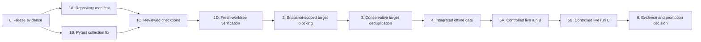

# Recovery implementation plan — 8 Sep 2026

## Outcome

Produce a reproducible checkpoint, close the target-poisoning and false-deduplication bugs, restore a one-command offline health check, and complete two clean live STS2 validations before enabling training export or `skill_on`.

**Execution status:** Phases 0–4 completed at checkpoint `637cae4`. Clean-worktree validation passed (968 tests, 5 expected skips). Next gate is controlled live Run B, followed unchanged by Run C if clean.

Estimated elapsed engineering effort: **2–4 working days**, excluding model downloads. Most bounded work is assigned to `gpt-5.6-luna`; the primary agent retains cross-module decisions, integration, and live-system authority.

## Non-negotiable invariants

- Preserve all existing user changes; no reset, clean, blanket staging, or destructive worktree operations.
- Never track `.env`, live runs, saves, downloaded weights, caches, raw collection logs, or temporary diagnostics.
- Same stale snapshot must remain fail-closed; a fresh observation must not inherit a transient target failure forever.
- Same name is supporting evidence, never sufficient by itself to merge targets.
- No runtime failure, safety rewrite, unverified action, mixed prompt id, or incomplete episode becomes training data.
- Lower-tier agents do not operate the live game, send input, commit, merge, or make release decisions.

## Agent topology and cost controls

### Primary coordinator

Owns the task graph, architecture decisions, review of every runtime diff, integration, final offline gate, live run authorization, and documentation sign-off. It resolves any change spanning both `loop/agent/loop.py` and the target-collapse contract.

### Lower-tier lanes (`gpt-5.6-luna`, low or medium reasoning)

- **R — repository manifest:** read-only classification of tracked/untracked files and a proposed allowlist/exclusion list.
- **T — test runner:** isolated `pyproject.toml` pytest configuration and its focused verification.
- **B — target blocking:** snapshot-scoped target quarantine plus focused/replay tests.
- **D — deduplication:** strict same-sprite predicate, metadata safety, telemetry, and geometry fixture matrix.
- **V — verification:** read-only targeted/full test execution and comparison against the recorded baseline.
- **E — evidence/docs:** summarize completed test/live evidence into `system.md` and validation reports after gates pass.

Cost rules:

- Give each agent only the audit, the relevant functions, and its owned tests (`fork_turns: 3` or a short task packet), not the full conversation.
- Use low reasoning for inventory, test execution, and documentation; medium reasoning for B and D.
- Run focused tests after each edit; run the 967-test suite only at integration gates.
- Reuse the same lane for one correction pass. Escalate to the primary agent after two failed correction cycles, a new live failure class, or a contract ambiguity.
- Do not parallelize B and D: both affect target publication and `test_perception_v3_replay.py`.

## Execution graph



## Phase 0 — freeze evidence and establish ownership

**Owner:** primary coordinator. **Edits:** none.

1. Capture `git status --short --untracked-files=all`, `git diff --stat`, HEAD, Python version, and current test results.
2. Preserve the incomplete `20260908T202041Z_sts2_collect` as diagnostic evidence; do not present it as a completed episode.
3. Assign exclusive file ownership per lane. Agents working in the shared workspace must not edit the same file concurrently.
4. Record the baseline: 967 passed / 1 skipped with importlib mode; plain pytest collection failure; 838 loop tests; one `mss` deprecation warning.

**Gate:** evidence bundle and file ownership are explicit; no live collector is modified or stopped.

## Phase 1 — make the repository reproducible

### 1A. Classify the workspace

**Owner:** lane R, read-only. May run in parallel with 1B.

Produce a reviewed allowlist for source, packaging, configs, fixtures, tests, and current docs. Separately list exclusions: `.env`, `runs/`, `data/loop/`, `data/memory/`, `.cache/`, caches, editor state, `_tmp_*`, `collect_*.log`, monitor state, downloads, and saves. Flag `games/`, PDFs, and large binary fixtures for an explicit human decision.

Do not use `git add .`. Do not modify ignore rules until each noisy path is classified; `.cursor/` may contain intentional project guidance.

### 1B. Repair plain pytest collection

**Owner:** lane T. **Owned file:** `pyproject.toml` only.

Add a pytest configuration equivalent to:

```toml
[tool.pytest.ini_options]
addopts = ["--import-mode=importlib"]
testpaths = ["tests"]
```

Verify plain `python -m pytest -q` completes collection and matches the known baseline. Do not rename tests in the same change.

### 1C. Prepare the reviewed checkpoint

**Owner:** primary coordinator, using lane R's manifest.

Selectively stage every required runtime/import/package/test/doc file and inspect the staged name list, statistics, whitespace, and secret-sensitive files. Include `system.md`, `AUDIT-2026-09-08.md`, and this plan. A commit is made only as an explicit reviewed implementation checkpoint; no unrelated cleanup is folded into it.

### 1D. Verify from a fresh worktree

**Owner:** lane V runs checks; primary coordinator reviews. **Environment:** offline/no live input.

From the reviewed checkpoint in a separate worktree and fresh virtual environment:

```powershell
python -m pip install -e .
python -m pip check
python -m pytest -q
python -m compileall -q avatar loop tests scripts eval bugfix
python -c "import avatar, loop; print('imports ok')"
```

Also load all installed `avatar-*` entry points. Record `python --version` and a dependency snapshot. Do not enable `AVATAR_LIVE_INPUT`, launch Steam, or call model services.

**Phase gate:** a clean checkout installs, imports, and reproduces the full test result without any file from the original untracked workspace. No secret/runtime artifact is staged.

## Phase 2 — fix target poisoning

**Owner:** lane B implements; primary coordinator approves the state contract.

**Primary files:** `loop/agent/loop.py`, `tests/loop/test_combat_fail_closed.py`, `tests/loop/test_perception_v3_replay.py`.

Preferred design:

1. Scope `_blocked_targets` to the failed `snapshot_id` or equivalent inventory generation.
2. Pass that identity through `_record_blocked_target`, `_target_is_blocked`, pruning, and `_build_turn_snapshot`.
3. Suppress the id only when evaluating the same stale snapshot.
4. Clear quarantine on a new action surface, forced rescan/current-surface reacquisition, combat exit, or episode reset. If no trustworthy identity exists, expire it on the next fresh observation; never retain it indefinitely because host count is `None`.
5. Keep host enemy count change as a secondary invalidation signal, not the correctness boundary.
6. Log target id, failed/current snapshot ids, host counts, and clear reason in existing run diagnostics.

Required tests:

- Same-snapshot retry remains blocked.
- Fresh snapshot restores the same `enemy_1` while host count remains one.
- Fresh snapshot restores it when host count is missing.
- A prior `enemy_1` failure cannot poison a new `enemy_2`.
- Replay the latest live sequence: target failure → forced rescan → visible enemy remains targetable; repeated targetless snapshots do not occur.
- Existing combat fail-closed and deduplication tests remain unchanged and green.

Verification order:

```powershell
python -m pytest -q tests/loop/test_combat_fail_closed.py tests/loop/test_perception_v3_replay.py
python -m pytest -q tests/loop
python -m pytest -q
```

**Gate:** transient rebound failure cannot suppress the only visible enemy on the next fresh snapshot; stale-frame retry remains fail-closed; all offline suites pass.

## Phase 3 — make target collapse conservative

**Owner:** lane D after Phase 2 integrates. Primary coordinator reviews metadata semantics.

**Primary files:** `loop/memory/screen_objects.py`, `loop/agent/loop.py`, `tests/loop/test_screen_objects.py`, `tests/loop/test_perception_v3_replay.py`.

Preferred design:

1. Remove “same normalized name plus any x-range overlap” as a standalone merge rule.
2. Accept a merge only with strong same-sprite geometry: near-identical IoU/centers, or a bounded vertical HP/body stack with vertical dominance and meaningful column overlap.
3. Treat same name as corroboration. Different populated names reject the merge.
4. Use host enemy count, when available, as a floor/check on the final target inventory. Do not use `host_enemies > 1` as a blanket veto because each of several enemies may still produce an HP/body duplicate.
5. Preserve the winner's executable id and bbox. Copy missing anonymous metadata only after a proven same-sprite merge. Conflicting populated HP/intent/name values must reject the metadata copy or the merge and increment a diagnostic.
6. Count candidate, accepted, geometry-rejected, host-floor-rejected, and metadata-conflict events in existing run diagnostics.

Fixture matrix:

- All recorded B5/B6 HP/body and dead-band Nibbit shapes collapse to one target.
- Anonymous plate plus named body collapses to one named target.
- Two same-name enemies with partial x overlap and different HP remain two.
- Two vertically staggered same-name enemies with host count two remain at least two.
- Far-apart boxes whose x-ranges overlap remain two.
- Different names with near-overlapping geometry remain two.
- Conflicting populated metadata never crosses between retained id/bbox pairs.

**Gate:** recorded duplicates are closed without erasing legitimate same-name multi-enemy targets; target ids and metadata remain internally consistent; focused, loop, and full suites pass.

## Phase 4 — integrated offline release candidate

**Owner:** lane V executes; primary coordinator diagnoses failures.

Run plain full pytest, loop tests, dependency integrity, compilation, imports, entry-point loading, Markdown-link checks, and `git diff --check`. Compare against the Phase 0 baseline and record test counts/duration/warnings.

Address `mss.mss()` deprecation in a separate small change after verifying `mss.MSS()` compatibility. Add Ruff/type checking and dependency constraints as later scoped hardening work; do not make a new lint regime block the correctness release candidate.

**Gate:** clean-worktree verification passes with no collection workaround, no new warnings, and no unexplained test-count change.

## Phase 5 — controlled live qualification

**Owner:** primary coordinator plus human operator. Lower-tier agents may parse completed logs only.

Use a fresh Ironclad combat start, known-good 16:9 client geometry, `no_skill`, and one explicitly recorded sensor/model configuration. Do not change flags between comparable runs. Run the cooperative monitor, but require normal finalization with `turns.jsonl`, `episodes.jsonl`, `summary.json`, frame artifacts, and exit status.

Run B acceptance:

- combat won and reward→map completed;
- zero target/source-not-found, targetless-visible-enemy loops, duplicate/noncanonical ids, decision softlocks, and repeated unverified-action loops;
- card effects verified and positive host-derived transitions observed;
- unexpected named merges and metadata conflicts equal zero;
- forced-rescan rate reported, with target ≤ 0.30.

If Run B fails, stop. Preserve evidence, route the new failure to one bounded lower-tier diagnosis, and return to the owning phase. Do not patch during a live run.

If Run B passes, repeat unchanged as Run C. Two consecutive clean wins close the live gate.

## Phase 6 — documentation and promotion decision

**Owner:** lane E drafts; primary coordinator signs off.

Update `bugfix/perception3/validation-report.md`, `system.md`, `AUDIT-2026-09-08.md`, and any README/config prose contradicted by final behavior. Record exact commit, Python/dependency snapshot, models, sensor flags, geometry, run ids, test counts, and gate results.

Only after every gate passes may the coordinator propose enabling `skill_on`, exporting SFT/DPO, or declaring perception v3 complete. Promotion is a separate explicit decision, not an automatic consequence of two wins.

## Stop and escalation rules

- Stop immediately on secrets in the staged set, clean-worktree import failure, test-count loss, or a new live input/safety failure.
- Return a lane to the same lower-tier agent once for a focused correction.
- Escalate to the primary agent after two failed correction cycles, conflicting invariants, changes spanning multiple ownership lanes, or any new live failure class.
- Never weaken truth gates, increase retry bounds, or broaden geometry thresholds merely to make the validation pass.
