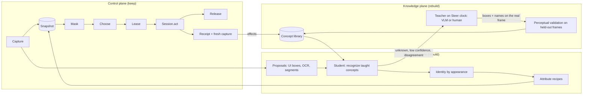

# Architecture review: teachable perception

Status: direction agreed 2026-09-30 (decisions in §11); Phase 0 spike not started. No code has changed. This will replace the perception sections of the [north star](perception-reaction-orchestration-north-star.md).

## 1. Bottom line

- The **control plane** is strong and should stay: capture provenance, leases, `Session.act`, the release clock, receipts and fail-closed gates. It is not what's blocking progress.
- The **knowledge plane** is what fails. The schema cannot describe what an object *looks like*, so the orchestrator has no way to teach See a new kind of object. Anything without text (enemies, card art, intent icons, health bars, the gear) can only get into the system through hand-written, game-shaped code. That is the patching loop Gate E has been stuck in.
- Your instinct is right: **the orchestrator has to teach the sensors.** Concretely, it should label pixels (boxes and points on the real frame). A fast, small "student" recognizer then turns those examples into detection on every frame. A separate *perceptual* validation step decides whether the student has learned the concept.
- The technology for this now exists at a size that fits a 4060. There are exemplar-prompted detectors (YOLOE-26 visual prompts, SAM 3 exemplars) and training-free reference matching (SAM + DINO memory banks). There are also small vision-language models that can ground objects as boxes or points (Rex-Omni 3B, the Qwen3.5 small series).
- Recommendation: **spike first** (§9, Phase 0). Run a two-day measurement on the saved STS2 frames before any rebuild. If it works, rebuild the knowledge and perception planes around a *concept library*, and replace Gate E with a teachability gate plus a "play one combat turn" gate.

## 2. What the system actually learns today

Evidence from the 22 live workspaces in `.tmp/` and a direct read of their schemas:

- **Fields: anonymous OCR numbers pinned to screen positions.** `sts2-full-20260922-105336` ended with 15 fields such as `field_c000` and `field_c013`. Three of them sit on the same box (the draw-pile count, `[0.038, 0.946, …]`), and two more share another box. One field has a name: `turn`, from the "Turn" banner.
- **Objects and modes: effectively none.** There is one entity type, `type_unit`, whose classifier is `{has_label: true, has_numeric: false}`, which matches any text node. There is one mode, `mode_default` (`min_fields: 1`). No relations: `promote` treats `relation` as a no-op ([orchestrate.py:1058](../loop/adaptive/orchestrate.py)).
- **Actions: one, and it's the wrong one.** Across every real-game run, the only action ever promoted is **Settings** (`sts2-arm3`). The other promoted actions come from synthetic fixtures.

So after hundreds of frames, the "world model" is "numbers at coordinates". It has no concept of enemy, card, player, HP or turn phase. That isn't a tuning problem: nothing in the architecture can produce those concepts.

## 3. Root causes

1. **The schema has no perceptual vocabulary.** `EntityTypeSpec.classifier` is a dictionary of predicates over whatever attributes perception already emits ([schema.py:165](../loop/adaptive/schema.py)). `SensorRecipe` is OCR, region, color or motion over a fixed ROI ([schema.py:179](../loop/adaptive/schema.py)). The orchestrator can *name* existing evidence, but it cannot *create a detector*. Every new object kind therefore needs new Python in perception: the card splitter, `_HAND_CY = 0.55`, title anchors, the hand-box routing.
2. **The orchestrator is blind and has no sense of space.**
   - The schema scout never receives the image: `run_scouts` calls `fn(bundle)` without a frame ([experiment.py:280](../loop/adaptive/experiment.py)), even though `system.md` step 5 says it gets one.
   - The bundle strips geometry, and `filter_model_diffs` drops anything containing coordinates ([orchestrate.py:109](../loop/adaptive/orchestrate.py)).
   - A frontier model given this bundle cannot say "the green creature is an enemy, and the 45/45 under it is its HP."
   - The coordinate ban exists to stop the model *acting* on coordinates, but it also stops it *teaching* where things are. Those are different authorities.
3. **Perceptual and causal knowledge are validated the same way.** Repeating a verified effect is the right test for an *action*. It's the wrong test for "this is a card." With no perceptual validation path, the only thing that can ever be promoted is a text-labelled button with a reversible effect, which is exactly how Settings got through.
4. **Identity is tied to text.** The registry keys controls by their label. The north star says icon-only controls "are not keys" and defers linking by appearance and "visual-only state" ([north star §Perception, §Deferred](perception-reaction-orchestration-north-star.md)). In a game, most of the state *is* visual, so the vision defers most of its own target domain.
5. **The evaluation contradicts the learning premise.** Gate E asks whether an *untaught* generic detector recovers a hand-annotated ontology (player, enemy, card, end_turn) on 3 frames. A learning system should instead be measured on teachability: after K teaching events, does it find those concepts on frames it hasn't seen? The gate also can't pass as written, because `qwen_resident` is hardcoded to `False` ([visual_object_fusion.py:1205](../benchmarks/visual_object_fusion.py)).
6. **The model budget rules forbid the standard solution.** The north star rules out "several vision models at once" and "a foreign vision encoder". Those rules protect the reaction model's inputs, but they also forbid a small student recognizer beside the VLM. That student costs roughly 100–300 MB.
7. **The action vocabulary is single clicks.** Playing a card in STS2 is select-then-target, sometimes a drag. `ActionSpec` can express parameterized actions, but nothing proposes them, because there are no entities to bind parameters to. Perception has to come first.

## 4. What others do (and what transfers)

| Work | How it perceives | What transfers here |
|---|---|---|
| Cradle (BAAI, 2024) | GPT-4o, plus Grounding DINO boxes and template matching, because GPT-4o "struggles with … game-specific icons" and locating enemies | A generic VLM alone is not enough on game art; exemplar-based recognition fills the gap |
| AgenticSTS (2026) | Game state as **text** from structured state (not pixels); Gemini 3.1 Pro with 5 memory layers; 6/10 wins at A0 | Once state is structured, strategy becomes tractable. Our blocker is purely pixels → structured state |
| NitroGen, Game-TARS, Lumine (2025) | End-to-end vision-action models trained on 40k hours of video, or 500B tokens, or a 7B VLM at 5 Hz | Proves pixels-only play is possible, but only at data and compute scales we don't have. Useful as future teachers, not as the plan |
| AXIOM (VERSES, 2025) | Object-centric mixtures that *grow a new component from a single event* and prune later | The right shape for a concept library: grow on surprise, merge and retire later |
| VisualPredicator (2024) | Invented predicates are small programs that call a VLM for perceptual queries | The orchestrator authors *recipes* that sensors then execute cheaply |
| No Time to Train (2025) | SAM proposals + DINO feature memory bank → training-free reference-based instance segmentation | The student can be training-free: add examples, and recognition updates immediately |
| YOLOE-26 (Ultralytics, 2026) | Detector with text prompts, *visual prompts* (an example box stands in for a class name) and prompt-free modes. Prompt embeddings can be saved and reloaded | A ready-made fast student. Its weak spot is rare categories (26s: 28.6 visual vs 30.8 text mAP), so it needs measuring |
| SAM 3 / 3.1 (Meta, 2025–26) | Concept segmentation from text *and image exemplars*; 1 exemplar adds +11 CGF1, 3 exemplars add +18.6 | Best quality, but ~840M params and ~2.9 s per image in Ultralytics' test. Usable only as an offline refiner on the Learn clock |
| Rex-Omni 3B, Qwen3.5 small series | Small VLMs that ground objects as boxes or points (Rex-Omni is the top 3B on ScreenSpot); Qwen3.5 0.8–9B is natively multimodal and Apache-licensed | Candidate *local* teachers that can load on demand on 8 GB |
| Twin (2026), PoE-World (2025) | An LLM writes executable world models and validates them by replaying against observations | Phase 3+: learning effects and goals once perception yields objects. Twin: "the harder problem is inferring the right goal" |

## 5. Proposed architecture: Teach → See → Verify

### 5.1 Three planes

| Plane | Decision | Contents |
|---|---|---|
| Control | **Keep, freeze** | Capture/provenance, snapshot register, mask, Choose, lease, `Session.act`, release clock, receipts, directive register |
| Perception | **Rebuild** | Generic proposals → student recognizer → identity by appearance → attribute recipes |
| Knowledge | **Rebuild** | Concept library (schema v2), teacher loop, perceptual and causal validation |

### 5.2 Concept library (schema v2)

Each concept is an immutable, versioned record inside the schema revision:

```text
Concept
  concept_id, kind: entity | control | field | screen_marker
  name                      # teacher's hypothesis; advisory text only
  exemplars[]               # (frame digest, box or mask, +/-) — pixel evidence, hashed
  student                   # compiled artifacts: visual-prompt embedding, prototypes, thresholds
  attributes[]              # recipes relative to an instance: "OCR the band below the box" → hp
  relations[]               # learned later from effects: "card can target enemy"
  validation                # held-out precision/recall, persistence, teacher agreement, n_frames
  status: hypothesis | provisional | promoted | retired
```

- **Fields** become attributes of instances (`enemy[i].hp`) or of screen markers (`gold`), not raw screen coordinates.
- **Modes** become learned screen types: clusters of which concepts are present (for example, combat means enemy + card + end-turn visible).
- `SensorRecipe` stays, but it is now compiled *from* concepts.

### 5.3 Teacher (the orchestrator, on the Steer clock)

- **When it wakes:** the student reports an unknown object or low confidence; a new screen type appears with unexplained coverage; teacher and student disagree on a spot-check; an effect repeatedly fails. Most of these triggers are already Steer wake events in the north star.
- **What it gets:** the real frame, the student's current detections, and the concept library.
- **What it returns:** concept proposals with **boxes or points on the image**, a name, positives and negatives, and attribute hints ("the number under this box is its HP").
- **Authority split:** teaching geometry is *evidence*. It never becomes an action or a click. Action authority stays exactly where it is today.
- **Who can teach**, in order of quality, to be decided in §11:
  1. a cloud frontier VLM;
  2. a local grounding VLM loaded only while observing (Rex-Omni 3B, or Qwen3.5-4B/9B quantized);
  3. a human, clicking boxes in a small labelling panel.

### 5.4 Student (the See clock, on settled frames)

1. **Proposals:** GPA UI boxes (already used), YOLOE prompt-free boxes, OCR tokens, connected components.
2. **Recognition:** YOLOE-26 with the concept's saved visual-prompt embeddings, and/or nearest-prototype matching on DINOv3 features. Below threshold, a proposal is **unknown**, which wakes Steer. Unknown never becomes an offer.
3. **Identity:** the existing tracker, with its 8×8 appearance swapped for a feature embedding. Identity then survives label changes, hover scaling and animation.
4. **Attributes:** OCR and bar-fill readings bound to instance-relative regions.
5. **Learn clock (after an episode):** fine-tune only YOLOE's classification head on the accumulated teacher labels, producing a new pinned student revision. Weights stay fixed while armed, as today.

Turn-based first: See runs when the screen *settles*, not on every frame. That removes most of the latency pressure.

### 5.5 Validation and promotion

| Knowledge | Promoted when |
|---|---|
| Concept (perceptual) | The student agrees with *independent* teacher labels on held-out frames the teacher didn't use as exemplars: ≥0.9 precision and recall over ≥20 frames covering ≥3 screen states, plus temporal persistence. A teacher can never validate itself on its own exemplar frame |
| Attribute / field | Repeated consistent reads, and value changes that line up with events |
| Action (causal) | Unchanged: the verified effect repeats. Actions now bind to concept instances, so two-step skills (card → enemy) become learnable |

The provisional "offer on first sight" rule stays, but it now applies to *recognized* controls, not only OCR text.

### 5.6 Flow



### 5.7 GPU budget (RTX 4060, 8 GB)

| Resident | Approx. VRAM | Source |
|---|---|---|
| Qwen3.5-0.8B reaction model | 1.7 GB | measured 2026-09-22 |
| GPA + OCR (OCR on CPU) + Qwen, whole device | 3.0 GB | measured 2026-09-24 |
| Student (YOLOE-26s or DINOv3-S) | ~0.1–0.3 GB | estimate; measure in spike |
| Local teacher, loaded only while observing (3–4B, 4-bit) | ~2.5–3 GB | estimate; measure in spike |

The peak is roughly 6 GB with the teacher loaded, so it fits only if the teacher isn't resident during armed play. A cloud teacher removes that constraint.

## 6. Proposed north-star changes

| Keep | Change | Drop |
|---|---|---|
| Pixels and executed input as the only boundary | Schema = concept library with exemplars and compiled student artifacts | Gate E as written |
| Lease, release, receipts, fail-closed, one decision in flight | Teacher may emit **teaching geometry** (never action geometry) | "Icon-only controls are not keys" |
| Reaction model as scorer of opaque ids | The scout/teacher receives the actual image | Deferral of linking by appearance and of visual-only state |
| Steer off the deadline; Learn after the episode | Perceptual validation path beside causal promotion | Ban on a small student vision model beside the VLM (keep it for the reaction request) |
| Game brief as advisory data | Turn-based: See on settled frames | Hand-written object code in perception (`card_proposals`, hand routing) once the student works |

## 7. How this resolves today's Gate E failures

| Failure | Today | Under the proposal |
|---|---|---|
| Hovered / fanned cards missing | Split inside one GPA hand box; heuristics | "Card" taught by exemplars; each card recognized by appearance at any scale. Hover and fan frames become teaching examples when the student misses |
| Actors (0/6) | No world detector in the lean path | "Player" and "enemy" taught once; recognized by appearance |
| Settings gear withheld | No text, so no key | Icon concept with an exemplar; the teacher classifies it once |
| Identity via OCR text | Label change means a new id | Appearance embedding + geometry |
| Gate can't pass | Hardcoded flag; 3 frames | Teachability gate on the existing 20/30 development/held-out split |

## 8. Risks — what could make this wrong

1. **Teacher quality on stylized game art.** Even cloud VLMs may box poorly. Mitigation: agreement between two teachers before a concept's exemplars are accepted; the spike measures this directly.
2. **Student recall on "rare" game art.** YOLOE's visual prompts are weaker on rare categories. Mitigation: DINO-prototype matching and a Learn-clock linear probe; the spike compares all three.
3. **Heavy overlap in fanned hands.** Occlusion is hard for any detector. Here the offer rule holds: withhold unless an instance is uniquely recognized.
4. **Licensing.** Ultralytics/YOLOE is AGPL-3.0; SAM 3 weights are gated; DINOv3 has its own license. That's fine for personal research, but it matters if you distribute this.
5. **Scope.** This rewrites perception, orchestration and schema: roughly 5–6k of the 20k runtime lines. The control plane and its ~600 tests stay.

## 9. Plan (spike first, gated)

- **Phase 0 — measurement spike, 2–3 days, no production code.**
  - *Data:* use the frozen 20 development / 30 held-out STS2 frames. With no human labels, the held-out answer key must come from a model family that isn't the teacher under test. Otherwise the teacher's blind spots are in the key too and get scored as correct. Claude (a third family, working in the coding session) drafts the key. The Gemma and Qwen outputs are used only to flag frames where Claude may have missed something; those frames are re-inspected, never copied. Frames that stay ambiguous are excluded and reported.
  - *Answer-key protocol:* Claude labels the held-out frames *before* any teacher or student runs on them. Each label is checked against a rendered box overlay. The key's hash is frozen before measurement. A later correction happens only through the logged "flagged → re-inspected" step, with a reason recorded.
  - *Teacher test:* `gemma4:31b-cloud` (the only free-tier cloud vision model) and local `qwen3.5:9b` (a different family, run alone on the 4060) each label cards, player, enemy, controls and HP on 10 frames. Score precision and recall against the key, plus latency and free-tier limits. If the local Qwen teaches well enough, the system doesn't depend on a cloud quota.
  - *Student test:* take exemplars from ≤3 development frames. Run YOLOE-26 visual prompts, DINOv3 prototypes, and the linear probe on the held-out frames, including hover and reduced-hand frames. Measure per-concept precision/recall, identity over a sequence, and p95 with Qwen resident.
  - *Gate:* ≥0.9 precision and recall per concept, and See p95 ≤ 500 ms on the 4060.
  - *If it fails:* try a stronger teacher, then more exemplars per concept, then the linear-probe student, before changing the architecture.
  - **Result (2026-10-01; details in `.tmp/phase0/PROGRESS.md`):** gate partly met. Teacher = Gemma4 + SAM2 box tightening (finds 98% of cards). Student = training-free DINOv2 feature templates, ≤0.2 s and <0.3 GB: player, enemy, End Turn, energy and piles at ~0.9–1.0 precision and recall. Cards reach 0.95 precision / 0.78 recall, missing Defend cards that one shared "card" threshold cuts off; small icons and HP bars fail. YOLOE visual prompts are weaker; fine-tuning on 3 frames is worse; local Qwen is too slow (74 s/frame). Phase 1 must add: several appearance prototypes per concept, each with its own threshold; instance-level duplicate suppression; a high-resolution second pass for small objects. The spike's frozen set covered one encounter; generalization was unmeasured (see the sample corpus below).
- **Phase 1:** concept library (schema v2) and teach API; student in See behind a flag; embedding identity. *Gate:* the Phase 0 numbers reproduced through the real `SceneAssembler`.
  - **Result (2026-10-01; details in `.tmp/phase1/REPORT.md`):**
    - **Gate met for the core concepts.** Phase 0 is reproduced exactly (bit-identical kernels). `concepts.py` (schema v2) and `student.py` sit behind `--tracker student:<dir>`; the default is unchanged.
    - **Protocol:** thresholds come from teacher labels, scored on the frozen key with 2-fold splits.
    - **Accuracy through `SceneAssembler`:** card 0.99/0.90; player, enemy, End Turn, energy, piles and settings 0.96–1.00.
    - **Main fix:** instance duplicate suppression (card precision 0.70 → 0.99). Several prototypes per concept made no difference on one encounter.
    - **Below the gate:**
      - menu buttons (recall 0.80) and intents (precision 0.77);
      - HP bars (0.59), which need attribute recipes;
      - map and deck icons, where the teacher's exemplars landed on the wrong icon, so teacher errors need a correction loop.
    - **Latency:** the student meets p95 ≤ 500 ms (488 ms with Qwen3.5-0.8B resident and generating). Full See is about 1.9 s, dominated by the existing CPU OCR (baseline 1.4 s without the student).
  - **Sample corpus (2026-10-01):** the "one encounter" gap was a spike artifact. Past collect runs held ~7,200 STS2 and ~1,350 Elden Ring observation frames, plus the retired screenshot-replay fixtures (git `d64342f^`).
    - `scripts/build_samples.py`, `tag_screens.py` and `split_samples.py` dedupe them (DINOv2) into `data/samples/`: 1,546 STS2 frames from 210 runs and 1,109 Elden frames from 30 runs.
    - Each frame is tagged by screen type through Gemma (metadata only).
    - Splits are made by run, so eval encounters never teach.
    - STS2 covers combat, map, rewards, events, tutorial, menus, dialogs and card grids. Shop interiors and rest sites are nearly absent (1–2 frames).
    - Elden is one indoor area: exploration plus popups.
- **Phase 2:** teacher loop on Steer (wakes on unknowns); perceptual promotion; teachability gate on held-out frames plus a 30-frame identity sequence. Run the same gate on a **second game with a different art style** now rather than in Phase 4, so STS2 can't shape the design.
- **Phase 3:** instance-bound fields and two-step skills (card → target) with causal verification. *Gate:* one armed STS2 combat turn played end to end from pixels, every action receipted.
- **Phase 4:** Learn-clock student fine-tunes, effect/goal world models (Twin/PoE-style), and a second game to prove generality.

## 10. What to stop now

- Gate E repair work and any new card or hand heuristics.
- New control-plane features: the control plane is ahead of the knowledge plane.
- The DINO, SAM2 and YOLO-World live adapters stay parked. They become teacher or refiner candidates in the spike or get deleted.

## 11. Decisions (2026-09-30)

| Question | Decision | Consequence |
|---|---|---|
| Teacher source | Cloud allowed | Cloud model teaches; the student and reaction model stay local |
| Providers | Free Ollama tier only (no OpenAI key) | The free cloud tier has one vision model, `gemma4:31b`; `gpt-oss` and `nemotron-3-*` are text-only. Teacher candidates are `gemma4:31b-cloud` and, locally, `qwen3.5:9b` (with `qwen3.5:4b` and `qwen3-vl:4b` as lighter options), all through the existing `VlmGateway` |
| Human teaching | Not for now | Evaluation labels come from two independent cloud labelers (§9) |
| Goal | Many games; improve through post-training | Cross-game prior memory and a training store (§12); second game in Phase 2 |
| Hardware | 4060 for runtime; slow teaching OK | Teaching runs while observing and never blocks Choose or Release |
| Use | Research | AGPL YOLOE, gated SAM 3 and DINOv3 terms acceptable |
| North-star vision-model rules | Relaxed for perception | One student model may sit beside the VLM |
| Gates | Teachability + one armed combat turn | Gate E retired |
| Orchestrator scope | Perception first | Effect and goal models in Phases 3–4; the notebook (§12) is designed now so goals have a home |

## 12. Memory and the orchestrator harness

### What exists

| Memory | Scope | Gap |
|---|---|---|
| Evidence ledger (append-only JSONL) | one run | A log, not knowledge. It grows fast (134k lines in one 30-frame run, mostly OCR) and nothing ever condenses it |
| Schema revisions + HEAD | one workspace/target | Holds only OCR fields today; becomes the concept library (§5.2) |
| Label + appearance registry, tracker lost-memory | in-process | Lost at exit; fine for instances, wrong place for concepts |
| Proposal cache | one workspace | Response cache keyed by input digest, not memory |
| Game brief | per game, static | Advisory prior, hand-written |
| Orchestrator memory | — | **None.** Every scout call starts cold |
| Cross-game memory | — | **None**, and `system.md` rule 8 forbids reusing a schema across targets |
| Training data | — | **None.** Learn has nothing curated to train on |

For one-game research the missing pieces were tolerable. For "many games, better after post-training" they are the product.

### Proposed layers

| Layer | Scope | Contents | Authority |
|---|---|---|---|
| Teacher notebook | one game session | Open hypotheses, questions, teaching log, refuted attempts ("tried X; failed because Y"), goal guesses | Advisory. Versioned and immutable like schema revisions |
| Provider reasoning state | one teacher session | Opaque state the provider carries between requests, with provider-side compaction | Performance cache only; never cited, never required |
| Concept library | one game (target) | §5.2 concepts, exemplars, student artifacts, validation | Authoritative once promoted; rule 8 still applies |
| Cross-game priors | global | Promoted concepts that recur across games (button, health bar, card, dialog, currency counter) with exemplars from each game, plus interaction patterns (select → target) | Advisory seed for a new game's teacher and student; every concept must re-validate in the new game |
| Episodic store | one run | Ledger, receipts, and the frames actually used for teaching or decisions (deduplicated by perceptual hash) | Record of what happened |
| Training store | global | Curated tuples (frame ref, teacher labels, student output, disagreements, decision, verified effect) | Read only by Learn; feeds student fine-tunes and reaction-model post-training |

Rule 8 stays as written for *authority*: a schema is never reused on another game. Cross-game priors are a new advisory channel, like the brief, so transfer never becomes a shortcut around validation.

### Semantic compaction of the notebook

- **When:** the notebook exceeds its token budget, at episode end, or when the screen type changes.
- **Promoted knowledge** moves into the concept library and leaves only a reference behind.
- **Refuted attempts** collapse to one line each but are never deleted, so the teacher doesn't loop on them.
- **Open hypotheses** stay verbatim with their evidence ids; rationale prose is summarized.
- **A deterministic check** rejects any compaction that drops an open hypothesis, a refuted attempt, or an evidence id a pending proposal cites. Each compaction is a new notebook revision, so a bad one can be rolled back.

### Carrying reasoning across calls

**Recommended for the cloud teacher, as a cache and not as memory.**

- ARC-AGI-3 is the closest public benchmark to "learn an unknown game by interacting". There, GPT-6 Astra scored 62.7% with a harness where the model keeps only its own notes. With a harness that also preserves the provider's opaque reasoning state between requests and compacts it provider-side, it scored 99.9%, 3.66× faster and with 49% fewer tokens on the games both solved. That is a large, measured effect on exactly our kind of task.
- **Guardrails:**
  1. The notebook and concept library are the system of record. The opaque state is a cache: if it's lost, expired, or the provider changes, the teacher restarts from the notebook. It is slower but still correct.
  2. It confers no authority. Anything that changes the schema still comes out as an explicit proposal with evidence ids and passes validation. We don't need to read the teacher's reasoning, because it can't act.
  3. Measure it on our own tasks: run the teacher with and without carried state on the Phase 0 frames and a live teaching session before relying on it. Keep the notes-only mode working so switching providers stays possible.
- **Not for the reaction model.** Qwen stays stateless per decision (plus the one prior verified outcome). Carried state there would add latency and make decisions depend on history that the lease doesn't cover.
- **With the current provider, this is deferred.** Ollama's chat API is stateless: it has no provider-held reasoning state to carry. So the notebook plus semantic compaction is the whole continuity mechanism for now, and it must work on its own anyway (guardrail 1). Revisit carried state only if a provider that supports it is added, and adopt it only if the with/without comparison shows a gain on our tasks.

## 13. Sources

- [SAM 3 — Ultralytics docs](https://docs.ultralytics.com/models/sam-3), [SAM 3.1 — Meta](https://ai.meta.com/blog/segment-anything-model-3/), [SAM 3 overview — Roboflow](https://blog.roboflow.com/what-is-sam3/)
- [YOLOE — Ultralytics docs](https://docs.ultralytics.com/models/yoloe), [YOLOE paper (ICCV 2025)](https://arxiv.org/abs/2503.07465), [YOLO26 paper](https://arxiv.org/pdf/2606.03748)
- [DINOv3 — Meta](https://ai.meta.com/blog/dinov3-self-supervised-vision-model/), [No Time to Train](https://arxiv.org/abs/2507.02798)
- [Rex-Omni](https://arxiv.org/abs/2510.12798), [Qwen3.5 small models](https://www.marktechpost.com/2026/03/02/alibaba-just-released-qwen-3-5-small-models-a-family-of-0-8b-to-9b-parameters-built-for-on-device-applications/), [Qwen3-VL report](https://arxiv.org/pdf/2511.21631)
- [Cradle](https://arxiv.org/html/2403.03186.pdf), [AgenticSTS coverage](https://the-decoder.com/ai-agents-win-at-slay-the-spire-2-after-researchers-replace-growing-chat-logs-with-structured-memory/)
- [NitroGen](https://nitrogen.minedojo.org/assets/documents/nitrogen.pdf), [Game-TARS](https://arxiv.org/abs/2510.23691), [Lumine](https://arxiv.org/abs/2511.08892)
- [AXIOM](https://arxiv.org/pdf/2505.24784), [VisualPredicator](https://arxiv.org/pdf/2410.23156), [PoE-World](https://arxiv.org/pdf/2505.10819), [Twin](https://arxiv.org/abs/2608.14490)
- [GPT-6 Astra on ARC-AGI-3 (harness comparison)](https://arcprize.org/blog/astra), [ARC-AGI results page](https://arcprize.org/results/openai-gpt-6-astra), [The harness catch](https://geotoolbox.ai/blog/gpt-6-astra)
