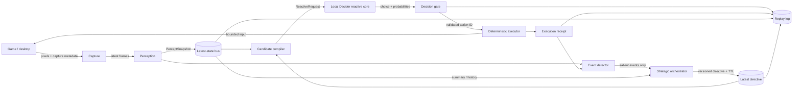
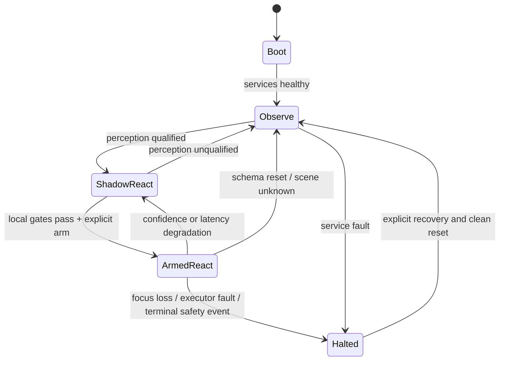

# Perception → Reaction → Orchestration North Star

Status: benchmark-oriented reference; native execution sequencing superseded by `native-decider-orchestration-plan.md`
Date: 2026-09-20
Primary proving ground: PlayJev Infinite Mario
Current hardware target: NVIDIA GeForce RTX 4060, 8 GB VRAM

> The canonical product-path plan is `native-decider-orchestration-plan.md`: native window capture, local Decider, and verified Win32 input through `Session.act()`.

This is the canonical specification for the current perception, reaction, and orchestration slice. `adaptive-orchestrator-plan.md` supplies the matching implementation sequence. Both defer learning until the fixed-weight reactive baseline is reliable.

## Decision

Build the playable system around three independently timed loops:

1. **Perception loop** — turns pixels and frame history into a compact, versioned, confidence-bearing world snapshot.
2. **Reactive loop** — uses a local Jev-like model to choose exactly one action from the currently valid candidate set on every actionable snapshot.
3. **Orchestrator loop** — runs slowly and asynchronously, establishes goals and strategy, and publishes a persistent directive that influences many reactive decisions.

Learning is deliberately deferred. The immediate objective is to make perception trustworthy, reaction fast, and the closed loop measurable. Trajectories may be logged for diagnosis, but no teacher, behavior-cloning, DAgger, RL, or online weight updates are required by this phase.

The reactive model remains provisional between **[`Mapika/decider-2b`](https://huggingface.co/Mapika/decider-2b), v10** and **[`Mapika/decider-0.8b`](https://huggingface.co/Mapika/decider-0.8b)**. Both will use the same local typed-decision adapter: they accept string or JSON state, score 2–255 described choices in one forward pass, and return probabilities without autoregressive output-token generation. The winner is selected by the combined quality, latency, and resource gate below. This prevents model size alone from deciding the architecture before the actual 8 GB machine is measured.

The model never creates coordinates, key names, scripts, or prose. It selects one opaque action ID from a supplied catalog. A deterministic adapter validates the typed answer and resolves that ID to an already-declared command.

## North star

> From trusted pixels to a bounded physical action before the observation becomes stale, while a slower strategic brain steers behavior without sitting in the frame loop.

The desired experience is not “an LLM thinks, then presses a key.” It is a continuously running control system:

```text
pixels → grounded state → valid choices → one-pass choice → validated action → new pixels
              ↑                                ↑
              └──── persistent strategy ───────┘
```

The system succeeds when it can:

- observe only what the player could see;
- maintain enough temporal state to understand motion and change;
- react at the environment's useful control rate;
- emit only schema-valid, executable decisions;
- continue acting while the orchestrator is idle or busy;
- change strategy promptly when meaningful events occur;
- replay and explain every action from recorded inputs and revisions; and
- fail closed when perception, state freshness, or execution authority is uncertain.

## Non-negotiable boundaries

1. **Pixels are environmental truth.** Instrumented Mario state may score perception and episodes, but it cannot enter live perceptual state, directives, reactive requests, or action selection.
2. **The reactive model is a scorer, not a command generator.** It can only select from candidate IDs provided in the request.
3. **The executor trusts the catalog, never model text.** Only the catalog owns key bindings, durations, coordinates, controller primitives, and release behavior.
4. **The orchestrator is not in the frame-critical path.** Its most recent unexpired directive is a cached input to the reactive loop.
5. **Every artifact is revisioned.** Snapshot, schema, action catalog, directive, policy, and environment episode identifiers travel with the decision.
6. **Stale work is discarded.** Queues are bounded and latest-value-wins; old frames are skipped, while an in-flight decision is retained only until its wall-clock age deadline and is revalidated before dispatch.
7. **Actuation remains armed and scoped.** Mario's benchmark adapter may execute benchmark candidates. Unknown desktop applications retain the existing fail-closed verified action boundary.
8. **No hidden learning dependency.** The first playable system must operate with fixed released weights and deterministic runtime components.

## Provisional reactive-model selection

### Selection

Qualify [`Mapika/decider-2b`](https://github.com/Mapika/decider) v10 and `decider-0.8b` against the same frozen scenarios. Select the highest-quality model that satisfies the local quality, latency, and resource gates. The initial preference is 2B if it clears those gates; 0.8B is a first-class outcome, not an emergency downgrade. The selected reactive core uses:

- BF16 weights;
- state-first prompt layout;
- one `Choice` question per action tick;
- short canonical JSON state;
- described, opaque action IDs;
- greedy `argmax` selection for the baseline;
- the complete returned probability distribution retained for gating and telemetry;
- one local model runner with process reuse treated as an optimization; and
- no schema cache until local accuracy and latency measurements justify it.

The repository identifies v10 as the main 2B release, reports about 4 GB BF16 use, supports JSON state and up to 255 choices, and describes a structurally constrained scoring head: option labels are scored and softmaxed, not decoded as text. The 0.8B release provides materially more headroom. Neither published benchmark nor weight footprint establishes local gameplay quality, so the selection stays open until both models face the same deterministic baseline and Mario scenarios.

The choice is still a hypothesis to qualify locally. Published speed numbers were measured on datacenter GPUs and cannot be transferred to an RTX 4060. Before the reactive loop is armed, the exact pinned model revision must pass the local latency, VRAM, determinism, and closed-loop gates in this document.

### Why not the alternatives

| Candidate | Strength | Why it is not primary |
|---|---|---|
| Decider 0.8B | Same typed interface, about 1.5 GB, maximum resource headroom | May win the combined local quality/latency/resource gate even if its general benchmark accuracy is lower |
| Bespoke Nimble 9B | Strong typed-decision accuracy and complete option probabilities | Unquantized weights alone are about 18 GB; its published one-question H100 p95 is 119.8 ms, so it does not fit the 8 GB/headroom/real-time target |
| SemIf with Qwen3.5-4B | Native option-logit scoring and a 3.01 GB Q4 browser build | It is a frozen general model rather than a game-adapted policy, and published fresh CUDA scoring is substantially slower than the desired action loop |
| PlayJev 0.8B | Direct pixel-to-action model and proven ten-game harness | Bypasses our explicit perception contract, is specialized through teacher-labelled game training, and scored only 0.32 of teacher-normalized performance on Mario |
| NanoJev 0.6B | Zero-token parallel choice probabilities; strong small-game examples | Current roadmap still lists broader structured-input support; released checkpoint is trained around its four specific games |
| Jevlike | Clean independent option-attention implementation | Primarily a trainable starter architecture; fixed released checkpoints are not the strongest general structured-state baseline |
| Decider 35B-A3B | Highest published Decider accuracy | Roughly 65 GB BF16 and therefore not a local option on this machine |

### Model selection gate

Run both models with identical prompts, candidate catalogs, frozen perceptual snapshots, and seeded closed-loop Mario episodes. Include a deterministic state-to-action baseline with no model. Select the model that satisfies all of these and has the highest scenario score:

- stable process startup and warm inference without out-of-memory failure;
- simultaneous operation with the chosen perception configuration;
- bounded VRAM with at least a 10% safety margin under a 30-minute stress run;
- reactive-model p95 latency low enough for the environment's step deadline; and
- no repeated capture/perception starvation caused by GPU contention;
- higher seeded scenario performance than the deterministic baseline; and
- no materially worse action validity, replay stability, or recovery behavior than the other candidate.

If both clear the gate, prefer the model with higher closed-loop scenario score, then lower p95 capture-to-dispatch latency, then lower peak VRAM. If neither clears it, keep the deterministic baseline as the only armed policy and record the model failure. Do not silently downgrade or promote a model from offline probabilities alone.

Record the model repository, immutable revision, dtype, engine settings, prompt-layout mode, tokenizer revision, and package lock in every run manifest.

## Complete runtime flow



### Step-by-step sequence

1. **Capture acquires a frame.** It assigns `episode_id`, `episode_generation`, monotonic `frame_id`, capture time, dimensions, source window identity, and a digest. A reset increments `episode_generation` before any new frame is published.
2. **Perception consumes the newest useful frame history.** It performs deterministic visual extraction, tracking, motion estimation, OCR, relationship derivation, and confidence aggregation.
3. **Perception publishes an immutable `PerceptSnapshot`.** Publication is atomic. The snapshot includes observation age, schema revision, evidence provenance, and quality status.
4. **The candidate compiler reads the latest snapshot, action catalog, and directive.** It filters unavailable or prohibited actions and produces a bounded set with stable opaque IDs and semantic descriptions.
5. **The reactive adapter constructs one typed request.** State contains the compact snapshot, current directive, recent action outcome, and timing metadata. The only question is “Which currently valid action best advances the directive from this state?”
6. **Decider performs one forward pass.** It returns one selected candidate and a probability for every offered candidate. No text decoding or parsing occurs.
7. **The decision gate joins model output with trusted metadata.** It checks membership, revisions, freshness, confidence policy, arming state, window focus, input budget, and catalog authority. It does not reject solely because a newer snapshot exists; it rejects when the decision exceeds its age deadline or fails dispatch-time preconditions.
8. **The executor validates again at dispatch.** It rechecks the active episode generation, target window identity/focus, catalog revision, action preconditions, and hold budget immediately before sending input. It then resolves the selected ID, executes a bounded press/hold/release sequence, and emits a receipt. No model-returned string is interpreted as input.
9. **Perception sees the consequence.** The event detector compares snapshots and the receipt to produce events such as progress, collision risk, death, win, no effect, uncertainty spike, or stall.
10. **The orchestrator wakes only when needed.** It consumes event summaries and recent state history, then publishes a new directive. Otherwise the prior directive remains active across many frames.
11. **The replay log closes the evidence chain.** It records references to the exact frame, snapshot, directive, candidates, model output, gate result, action receipt, and observed consequence.

## Timing model

The loops are asynchronous and have different responsibilities:

| Loop | Trigger | Initial target | Backpressure rule |
|---|---|---:|---|
| Capture | Clock / environment step | 30 Hz source where available | Ring buffer overwrites oldest frame |
| Perception | New useful frame | 15–30 Hz | Skip superseded frames; never accumulate a backlog |
| Reactive | New qualified snapshot and action slot | One decision per Mario step, up to 10 Hz initially | Keep one in-flight decision until its age deadline; revalidate preconditions at dispatch and discard only when stale, reset, or invalid |
| Execution | Accepted reactive decision | One bounded command | Never overlap incompatible commands |
| Orchestrator | Salient event, directive expiry, or low-rate heartbeat | Event-driven; at most 0.5–2 Hz initially | Coalesce equivalent events and publish atomically |

These are development targets, not claims about achieved performance. Mario advances by an approximately 100 ms virtual environment tick in the selected fixture. Virtual ticks measure game progression; monotonic wall time measures capture, inference, input, and deadlines. They must never be compared as if they were the same clock. The first hard system gate is:

```text
p95(capture complete → executor dispatch) < one environment step
```

The measured budget is then divided among capture, perception, request construction, model inference, gate validation, and dispatch. No component receives a guessed latency guarantee. If the budget fails, profile first; then revisit state compaction, perception frequency, model compilation, or the selected Decider checkpoint as measured by the same gate.

## Runtime topology

Keep the first implementation small and explicit:

```text
sequential runner: capture → perception → candidates → score → gate → step
                                             ▲                    │
                                             │                    ▼
                                  latest directive       receipts/events
                                             ▲                    │
                              one asynchronous orchestrator worker
```

The sequential runner owns the first end-to-end benchmark path and keeps the benchmark adapter/action boundary visible from the beginning. The orchestrator worker reads snapshots and receipts asynchronously and publishes directives through a latest-value register. Split capture, perception, inference, or execution into separate processes only after measured contention or fault isolation requires it.

Recommended channels:

- **Frame ring:** bounded in-memory ring; newest frame wins.
- **Snapshot register:** atomic latest-value register plus a small replay history.
- **Directive register:** atomic latest-value register with version and expiry.
- **Decision slot:** capacity one; a pending decision survives newer snapshots until its monotonic age deadline, but reset, terminal state, or failed dispatch-time preconditions invalidate it immediately.
- **Event queue:** bounded, deduplicated, prioritized; terminal and safety events cannot be dropped.
- **Append-only replay log:** durable metadata and hashes; image retention is separately configurable.

Avoid a general message-bus dependency in the first version. In-process queues and registers are sufficient for the sequential runner and single orchestrator worker. Introduce process boundaries only when measurements demonstrate a need.

## Data contracts

The following shapes are logical contracts. Exact language types belong in a later implementation ADR.

### `PerceptSnapshot`

```json
{
  "snapshot_id": "ep-0042:s-01821",
  "episode_id": "ep-0042",
  "episode_generation": 7,
  "frame_id": 1821,
  "captured_at_ns": 0,
  "published_at_ns": 0,
  "schema_revision": 12,
  "source": {"window_id": "...", "width": 448, "height": 336},
  "quality": {"status": "qualified", "confidence": 0.93, "age_ms": 7.4},
  "mode": "active_play",
  "controlled_entity": {
    "track_id": "entity-7",
    "box_norm": [0.18, 0.66, 0.05, 0.09],
    "velocity_norm_s": [0.21, -0.04],
    "confidence": 0.91
  },
  "entities": [],
  "relations": [],
  "signals": {"progress_direction": "right", "grounded": true},
  "recent_events": [],
  "evidence_refs": []
}
```

Rules:

- Geometry is normalized and originates only from perception evidence.
- Motion is derived from tracked frame history, not a privileged game state.
- Unknown values remain unknown; they are not filled by semantic guesswork.
- `quality.status != "qualified"` prevents normal reactive actuation.

### `StrategicDirective`

```json
{
  "directive_id": "dir-00031",
  "episode_id": "ep-0042",
  "episode_generation": 7,
  "revision": 31,
  "issued_at_ns": 0,
  "valid_until_ns": 0,
  "goal": "maximize safe rightward progress",
  "strategy": "maintain momentum; jump early for gaps or approaching hazards",
  "priorities": ["survive", "progress", "preserve momentum"],
  "hard_action_mask": {"allowed_action_ids": ["noop", "right", "jump", "right_jump", "right_run", "right_run_jump"], "forbidden_action_ids": ["left"]},
  "soft_preferences": ["prefer noop over blind action"],
  "attention": ["nearest forward hazard", "ground contact", "horizontal velocity"],
  "interrupt_on": ["death", "stall", "perception_unqualified", "goal_complete"]
}
```

A directive is strategic context, not a frame-by-frame command. It should normally survive dozens of reactive decisions. Hard constraints are compiled into a typed action mask before the model request; prose constraints are never trusted as enforcement. The orchestrator may narrow or rank behavior but cannot invent executable primitives. An empty hard mask is invalid and forces safe neutral/observe mode.

### `CandidateAction`

```json
{
  "action_id": "right_run_jump",
  "episode_id": "ep-0042",
  "episode_generation": 7,
  "description": "move right quickly while jumping; use for a forward gap or obstacle",
  "availability": "available",
  "risk": "medium",
  "max_hold_ms": 100,
  "command_ref": "mario:v1:action:6",
  "catalog_revision": 3
}
```

`command_ref` is never sent to the model. It is retained only in the trusted catalog used by the executor.

Candidate cardinality is explicit. With zero candidates, the request is not sent: release inputs, enter neutral/observe mode, and emit `no_valid_candidates`. With one candidate, bypass model scoring, emit a deterministic decision for that candidate, and retain the same gate and dispatch checks. With two or more candidates, invoke the reactive model.

### `ReactiveRequest`

The Decider adapter maps the runtime contracts to one typed request:

```json
{
  "episode_id": "ep-0042",
  "episode_generation": 7,
  "snapshot_id": "ep-0042:s-01821",
  "directive_revision": 31,
  "catalog_revision": 3,
  "state": {
    "observation": {"snapshot_id": "ep-0042:s-01821", "episode_id": "ep-0042", "episode_generation": 7, "mode": "active_play", "signals": {}},
    "directive": {"directive_id": "dir-00031", "episode_id": "ep-0042", "episode_generation": 7, "goal": "maximize safe rightward progress", "strategy": "...", "hard_action_mask": {"allowed_action_ids": ["noop", "right", "jump", "right_jump", "right_run", "right_run_jump"]}},
    "last_outcome": {"action_id": "right_run", "effect": "progress", "age_steps": 1}
  },
  "questions": {
    "action": {
      "type": "choice",
      "instructions": "Which currently valid action best advances the directive from this observation?",
      "criteria": {
        "noop": "release movement for one step; safest when state is uncertain",
        "left": "move left for one step; use only for recovery",
        "right": "move right for one step",
        "jump": "jump without rightward movement",
        "right_jump": "move right while jumping",
        "right_run": "move right quickly without jumping",
        "right_run_jump": "move right quickly while jumping"
      }
    }
  }
}
```

Keep state concise and addressed by stable keys. Do not send raw scene-graph dumps, long policies, chain-of-thought requests, or prose histories. Decider's own limitations show that long multi-step rules and large positional JSON collections are poor input shapes for the 2B model.

### Model answer and validated `ReactiveDecision`

Decider's raw typed answer is expected to contain only a selected option and scores:

```json
{
  "choice": "right_run_jump",
  "confidence": 0.71,
  "certainty": 0.58,
  "probabilities": {
    "noop": 0.03,
    "left": 0.01,
    "right": 0.06,
    "jump": 0.05,
    "right_jump": 0.11,
    "right_run": 0.03,
    "right_run_jump": 0.71
  }
}
```

The trusted adapter wraps it with provenance:

```json
{
  "decision_id": "decision-01821",
  "snapshot_id": "ep-0042:s-01821",
  "episode_id": "ep-0042",
  "episode_generation": 7,
  "directive_revision": 31,
  "catalog_revision": 3,
  "policy_revision": "Mapika/decider-2b@<immutable-v10-revision>",
  "action_id": "right_run_jump",
  "confidence": 0.71,
  "probabilities": {},
  "model_latency_ms": 0,
  "gate": {"accepted": true, "reason": "valid"}
}
```

The wrapper validates that probabilities are finite, cover exactly the offered candidates, fall in `[0, 1]`, and sum to one within tolerance. It never extracts a command from free text.

### `ExecutionReceipt`

```json
{
  "decision_id": "decision-01821",
  "action_id": "right_run_jump",
  "episode_id": "ep-0042",
  "episode_generation": 7,
  "target_window_id": "mario-window-1",
  "dispatch_started_at_ns": 0,
  "dispatch_finished_at_ns": 0,
  "executed": true,
  "focus_verified_at_dispatch": true,
  "released_all_inputs": true,
  "error": null
}
```

## Decision gate

The gate is deterministic and must reject a decision when any of the following is true:

- snapshot quality is not qualified;
- snapshot or decision exceeds the environment-specific age budget;
- episode, schema, catalog, or policy revision does not match the active runtime;
- directive revision was superseded, or its hard expiry elapsed;
- chosen ID is not present and available in the supplied candidate set;
- probabilities are malformed or non-finite;
- model confidence fails the current action-risk threshold;
- required focus, arming, or ownership checks fail;
- an incompatible action is already in flight;
- the environment terminated or reset after inference began; or
- the candidate's input budget would be exceeded.

At dispatch, the executor repeats the checks that can change while inference is running: active `episode_generation`, target window identity and focus, action catalog revision, action availability and hard mask, terminal/reset state, and hold/release budget. A decision that passed model-time validation but fails this second check is dropped and recorded as `dispatch_precondition_failed`.

On rejection, the system executes no inferred replacement. It releases held input, records the reason, and publishes an event. A separately declared deterministic fallback may choose `noop` only when the environment adapter defines `noop` as safe.

### Executor state machine and input semantics

The executor owns input continuity independently of model availability:

```text
Neutral → Pressing → Holding → Releasing → Neutral
    └──────────────→ Faulted → Neutral (after all-input release)
```

Each action declares a transition sequence and `max_hold_ms`. A new compatible decision may extend a hold only before that deadline; an incompatible decision first releases the previous action. Every dispatch arms an executor-owned wall-clock release timer. Model delay, orchestrator failure, focus loss, reset, terminal state, or process shutdown releases every held input and returns to `Neutral`. `noop` means release/maintain-neutral for one virtual game tick; it is not an implicit key command. The executor never waits for the next inference result to release input.

Confidence thresholds are action-risk policies, not proof that a model is correct. They must be calibrated from local replay and closed-loop outcomes.

## Orchestrator contract

The orchestrator owns:

- current objective and subgoal;
- strategic mode;
- priorities and constraints;
- attention hints for state compaction;
- recovery mode after stalls or failures;
- directive expiry and interrupt conditions; and
- requests for observation-only or halt modes.

It does **not** own:

- frame capture;
- object coordinates;
- per-frame action selection;
- raw key or controller commands;
- execution timing within an action step; or
- reactive-model weight updates.

### Wake conditions

Wake the orchestrator on:

- episode start, death, win, or reset;
- sustained no-progress/stall detection;
- a significant mode or scene transition;
- repeated low-confidence reactive decisions;
- perception quality degradation or schema change;
- repeated action-with-no-effect receipts;
- directive expiry; or
- a low-rate heartbeat when no event has occurred.

Do not wake it merely because a new frame arrived.

### Directive continuity

If a directive reaches soft expiry while an update is pending, the reactive loop may continue under it only when its constraints explicitly permit continuation. Hard expiry switches the system to the adapter's safe neutral policy or `observe` mode. An orchestrator failure must never freeze a held input.

### Reset and episode invalidation

Reset is a transaction: stop dispatch, release all inputs, increment `episode_generation`, clear the active target and directive, invalidate all pending decisions and candidate catalogs from the prior generation, then publish the first post-reset snapshot. `episode_id` identifies the logical run; `episode_generation` identifies the current reset boundary within the runner. Any mismatch rejects work even when timestamps and IDs otherwise look fresh.

## Operating state machine



- **Boot:** load pinned artifacts, warm the model, release all inputs, verify manifests.
- **Observe:** run capture and perception; do not ask the model to act.
- **ShadowReact:** produce and log decisions but do not dispatch them.
- **ArmedReact:** dispatch decisions that pass every gate.
- **Halted:** release all inputs, stop normal actuation, preserve evidence, require a clean recovery transition.

## Perception requirements for play

The reactive model cannot repair a lossy or unstable world snapshot. Before closed-loop play, perception must reliably provide:

- a stable controlled-entity track;
- position and bounding geometry in a normalized coordinate system;
- short-horizon velocity and acceleration where observable;
- ground/contact or equivalent locomotion state;
- nearest relevant obstacles, hazards, targets, or selectable regions;
- relative position, closing direction, and time-to-contact estimates where supportable;
- camera-motion compensation;
- scene/mode transition signals;
- confidence per field and overall snapshot qualification; and
- evidence provenance sufficient to replay the estimate.

Application-specific semantic labels are optional. The required baseline is geometrically and temporally useful state. A reactive request should prefer a few stable relations such as “gap ahead, near, approaching” over dozens of uncertain detections.

### Minimal Mario profile and bootstrap

The first Mario profile is deliberately small: player box and track identity; horizontal and vertical displacement over the last three frames; grounded/airborne estimate; visible solid platform spans; nearest forward gap or obstacle; camera scroll estimate; terminal/title state; and a qualified/unknown status for each field. It does not assume a game API, memory read, or hidden velocity. The bootstrap sequence is:

1. Calibrate the fixed capture viewport and detect the playfield bounds from pixels.
2. Collect a short no-input frame sequence to establish background, camera stability, and the player track.
3. Confirm the track through a controlled replay containing right movement, jump, scrolling, death, and reset.
4. Derive platform spans and forward gaps from the visible scene; mark unsupported geometry unknown.
5. Qualify a snapshot only when player identity, position, temporal displacement, and terminal state are available; airborne/grounded and hazard fields may remain unknown with reduced confidence.

The current architecture does not yet establish robust Mario player detection, platform segmentation, camera compensation, contact inference, or terminal-state detection from pixels. Those are perception implementation gaps, not reasons to add privileged state to the live path. Until this profile qualifies on replay, the system remains in `Observe` or `ShadowReact`.

## Infinite Mario proving ground

Use the PlayJev Infinite Mario fixture already selected in the broader architecture plan. It remains a systems benchmark, not a teacher-centric architecture template.

### Initial action catalog

```text
noop
left
right
jump
right_jump
right_run
right_run_jump
```

### Initial directive

```text
Goal: maximize safe rightward progress.
Priorities: survive, progress, preserve momentum.
Strategy: run right when the path is clear; jump early for a forward gap,
obstacle, or approaching hazard; use noop when the observation is unqualified.
```

### Fixture usage

- The reactive path receives only captured pixels transformed through the normal perception contract.
- Game-internal position, velocity, score, death, and win state are evaluation-only privileged data.
- The environment's action list supplies the trusted candidate catalog.
- Seeded reset and virtual time support reproducible latency and replay tests.
- Start with one page and one episode at a time. Vectorization belongs after the single closed loop is correct.
- Compare against random and simple deterministic baselines. PlayJev's released policy may be an external benchmark, not a teacher requirement.

The first milestone is not “solve Mario.” It is “reliably close the loop, make bounded actions from visual state, and measure why each failure happened.”

## Failure behavior

| Failure | Immediate behavior | Orchestrator signal |
|---|---|---|
| No qualified snapshot | Release inputs; `noop` only if adapter declares it safe | `perception_unqualified` |
| Snapshot or decision stale | Drop without execution | `deadline_miss` after threshold |
| Low-confidence low-risk action | Follow configured threshold policy | Aggregate only if repeated |
| Low-confidence risky action | Reject; safe neutral action if declared | `reactive_uncertain` |
| Model process unavailable | Enter shadow/observe; never synthesize a command | `policy_unavailable` |
| Directive soft-expired | Continue only within explicit continuation policy | `directive_refresh` |
| Directive hard-expired | Safe neutral or observe mode | `directive_expired` |
| Focus/window mismatch | Release inputs and halt | `focus_lost` |
| Action has no observed effect | Record; avoid blind retry unless catalog permits | `action_no_effect` after threshold |
| Reset/terminal during inference | Invalidate pending decision | `episode_transition` |
| Executor error or stuck input | Release all inputs and halt | `executor_fault` |

## Test strategy

### 1. Contract and property tests

- The model adapter cannot return an action outside the offered set.
- Reordered candidate maps preserve semantic selection within measured tolerance.
- Every probability vector is complete, finite, normalized, and keyed by candidate ID.
- Command handles and raw input primitives never appear in model requests.
- Privileged fixture state never appears in snapshots, directives, requests, or decisions.
- Revision mismatches and stale timestamps always reject.
- Reset increments `episode_generation` and invalidates every pending decision, directive, hold timer, and candidate catalog from the prior generation.
- `noop` is never invented when absent from the catalog.
- Zero-candidate requests never invoke the model; one-candidate requests never depend on model ranking.
- Dispatch-time focus, target, mask, and action-precondition changes prevent execution.
- Held inputs release at their executor wall-clock deadline even when inference and orchestration stop.

### 2. Perception replay tests

- Golden frame sequences produce bounded state error against evaluation-only labels.
- Tracking identity remains stable through scrolling and brief occlusion.
- Camera motion is distinguished from entity motion.
- Derived velocity and ground state are temporally consistent.
- Snapshot confidence falls when the necessary evidence disappears.
- Identical recorded inputs reproduce equivalent snapshots and qualification decisions.

### 3. Reactive replay tests

Run the pinned model over frozen snapshot/directive/candidate fixtures and record:

- selected action;
- full probability distribution;
- warm and steady-state latency;
- VRAM high-water mark;
- repeatability across identical requests;
- sensitivity to candidate order and irrelevant state fields; and
- behavior when key state fields become unknown or contradictory.

Model-output fixtures are regression evidence, not assertions that one action is universally correct. Closed-loop score and scenario-specific expected behaviors provide the behavioral tests.

### 4. Shadow-mode live tests

- Run capture, perception, directives, and Decider against live Mario without dispatch.
- Confirm all decisions are fresh and executable at the moment they would have fired.
- Measure end-to-end deadlines under sustained load.
- Separate virtual Mario tick advancement from monotonic wall-clock latency and release deadlines.
- Inspect whether confidence drops before visually ambiguous failures.
- Verify the orchestrator does not receive or emit per-frame traffic.

### 5. Armed closed-loop tests

Progress through fixed gates:

1. `noop` and release-only execution.
2. Rightward movement on a clear segment.
3. Jump timing on a fixed obstacle.
4. Recovery after an intentionally bad directive.
5. Full seeded episodes with the constant baseline directive.
6. Event-driven directive changes after stall, death, and mode transitions.

### 6. Fault injection

Inject stale frames, delayed model answers, model-process death, malformed probability vectors, focus loss, action-catalog changes, directive expiry, capture pauses, and episode resets. Each must produce the declared safe transition with all inputs released.

## Acceptance gates

### Perception gate

- Controlled entity is identified and tracked on the benchmark scenario set.
- Required geometry and motion fields meet scenario-specific error bounds.
- Qualification confidence separates usable from unusable snapshots on held-out replay.
- No privileged state contamination is detected.

### Reactive contract gate

- 100% of accepted decisions reference a currently offered action ID.
- 0 malformed or out-of-set decisions reach the executor.
- Identical request replay is stable under the pinned runtime configuration.
- Candidate-order perturbation does not create systematic option-position bias.

### Latency and resource gate

- 30-minute concurrent perception/reactive stress run without OOM or service restart.
- At least 10% VRAM safety margin at observed peak.
- p95 capture-to-dispatch is below the Mario environment step deadline.
- Stale decisions executed: 0.
- Capture starvation attributable to reactive inference: 0 sustained incidents.

### Orchestrator separation gate

- Reactive play continues for the directive's allowed lifetime while the orchestrator is paused.
- One directive governs many reactive decisions during ordinary play.
- Salient events cause a bounded-time directive revision.
- Orchestrator latency never causes a held-input timeout or frame backlog.

### System gate

- Every executed input has a complete replay chain.
- Unqualified snapshots producing inferred actuation: 0.
- Cross-episode, cross-`episode_generation`, or cross-revision decisions executed: 0.
- All fault-injection cases release inputs and reach the expected safe state.
- The seeded benchmark improves over random without privileged action inputs.
- The selected reactive policy must beat the deterministic baseline on the agreed seeded scenarios while clearing resource and latency gates.

## Implementation sequence

This is sequencing for future work, not authorization to implement it now.

### Phase A — freeze contracts and benchmark

- Pin the PlayJev fixture and model revisions.
- Define the six runtime contracts and revision rules.
- Implement the Mario benchmark adapter and its explicit `step(action_id)` boundary, including reset, virtual tick, action catalog, focus/target identity, and evaluation-only labels.
- Build replay fixtures from pixels plus evaluation-only labels.
- Establish random and deterministic benchmark baselines.

### Phase B — qualify perception

- Produce stable Mario snapshots from recorded frames.
- Validate temporal estimates, camera compensation, confidence, and replay.
- Keep actuation disabled.

### Phase C — qualify Decider locally

- Run both Decider 2B v10 and 0.8B through the same minimal local runner shape; process reuse is optional until profiling justifies it.
- Measure BF16 VRAM, warm latency, steady-state latency, contention, and seeded closed-loop quality.
- Exercise frozen structured-state scenarios.
- Select the winner using the documented combined quality/latency/resource gate; retain the deterministic baseline if neither qualifies.

### Phase D — close the reactive loop

- Add candidate compilation, typed request mapping, decision gate, and deterministic benchmark execution.
- Exercise the same executor state machine and dispatch-time target validation used by later desktop adapters.
- Pass shadow mode before arming.
- Progress through bounded Mario scenarios before complete episodes.

### Phase E — add asynchronous orchestration

- Start with a constant baseline directive.
- Add event detection and versioned directive publication.
- Add slow strategic updates, expiry, and recovery without changing the reactive contract.

### Phase F — harden and generalize

- Run fault injection and extended soak tests.
- Recheck that the benchmark adapter remains isolated from verified desktop skills while hardening the runtime.
- Add a second environment only after Mario's contracts and metrics are stable.

### Deferred — learning

Only after the perception and reactive gates are reliable should a separate design decide whether to add offline imitation, preference tuning, DAgger, RL, or another asynchronous learner. Any future learner must produce a versioned candidate policy, pass offline and shadow evaluation, and be promoted atomically. It must never mutate the live policy in place.

## Observability

Every tick should make these timings independently visible:

```text
capture_ms
perception_ms
snapshot_age_at_request_ms
request_build_ms
model_queue_ms
model_inference_ms
decision_gate_ms
dispatch_ms
capture_to_dispatch_ms
directive_age_ms
```

Also record:

- selected action and complete probability distribution;
- action-catalog and directive revisions;
- rejection and fallback reasons;
- perception confidence and missing required fields;
- executor receipts and observed effects;
- event-to-directive latency; and
- GPU memory and utilization at a low sampling rate.

Prefer traces that reference immutable payload hashes over duplicating full state into every log row.

## Known risks

1. **Out-of-the-box competence is not guaranteed.** Decider 2B and 0.8B are candidates, not proof that either understands our state vocabulary or can solve Mario without tuning.
2. **Perception may be the dominant error source.** Perfectly constrained output cannot compensate for missing motion or incorrect hazard geometry.
3. **Confidence is not correctness.** The model's published calibration does not transfer automatically to our snapshots and action semantics.
4. **Eight GB is workable but tight.** Actual runtime overhead and concurrent GPU consumers must be measured; model selection remains open until the combined gate is satisfied.
5. **Long directives can reduce accuracy.** The orchestrator must publish compact actionable context, not essays or hidden plans.
6. **Closed-loop errors compound.** Replay accuracy is necessary but only seeded live episodes expose recovery behavior and state-distribution drift.
7. **Benchmark actuation is not general desktop authority.** Mario's declared action catalog must not weaken the existing verified desktop action boundary.

## Source basis

- [`Mapika/decider`](https://github.com/Mapika/decider) — typed one-pass decisions, JSON state, model sizes, v10 history, game/browser results, speed notes, serving interface, and limitations.
- [`Mapika/decider-2b`](https://huggingface.co/Mapika/decider-2b) — selected model artifact; pin an immutable Hub revision during implementation.
- [`Mapika/decider-0.8b`](https://huggingface.co/Mapika/decider-0.8b) — resource fallback.
- [`bespokelabsai/nimble`](https://github.com/bespokelabsai/nimble) — higher-capacity typed-decision comparison and published memory/latency constraints.
- [`TheoLeeCJ/SemIf`](https://github.com/theoleecj/semif) — direct option-logit comparison using frozen local models.
- [`OmniJev/PlayJev`](https://github.com/OmniJev/PlayJev) — pixel-to-action reference and Infinite Mario fixture.
- [`TianyuCodings/NanoJev`](https://github.com/TianyuCodings/NanoJev) — 0.6B parallel-decision comparison.
- [`vinnylarouge/jevlike`](https://github.com/vinnylarouge/jevlike) — independent trainable Jev-shaped option scorer.

## Final architectural test

For any proposed component, ask:

> Does this help turn the newest trustworthy observation into a valid action before it becomes stale, or help the orchestrator provide better persistent direction without blocking that action?

If neither is true, it is outside the current north-star slice.
