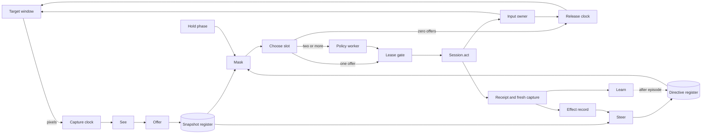
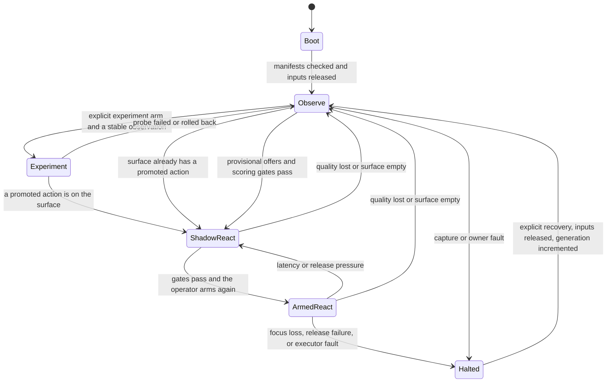

# Perception → Reaction → Orchestration North Star

Status: canonical vision
Date: 2026-09-22
Hardware target: NVIDIA GeForce RTX 4060, 8 GB VRAM
Build sequence: [`perception-play-plan.md`](perception-play-plan.md)

`system.md` and ADR 0001 are the product invariants. This document is the control-system vision. The build plan is the only execution sequence. `native-decider-orchestration-plan.md` keeps the stack proof and the earlier wave audit; it does not override this vision. `adaptive-orchestrator-plan.md` is the optional PlayJev benchmark note.

PlayJev and Playwright are fixtures. They are not input providers, action authorities, or acceptance gates for the product path.

## Decision

Run one fail-closed screen agent on five product clocks, plus **Release** as a peer of capture:

1. **See** — every new frame. Objects, labels, stable ids, and remembered values from pixels only. See does not choose a click and does not call the reaction model.
2. **Offer** — same frame, after See. Visible controls become choice ids immediately, including the first time they appear. Waiting for two reversible proofs before the first click is not required.
3. **Choose** — one in-flight decision. One offer: take it, no model. Two or more: one call to the pinned reaction model. Zero: release, no invented noop, no model call. A late answer is dropped.
4. **Steer** — the orchestrator. Publishes intent, a forbid-subset, and which fields are fresh. Wakes on a screen-signature change, an unlabeled element, a repeated failed effect, quality leaving trusted, directive expiry, or a slow heartbeat. Does not wake only because a frame arrived. Does not emit a primitive or pick the click.
5. **Learn** — after the episode, off the deadline. Reads the log. May publish a new value table or a new revision of the pinned checkpoint. Weights do not change while a run is armed.
6. **Release** — unchanged. Independent of perception, scoring, and orchestration.

A fresh workspace starts from `empty_schema()`, in `Observe`, with no confirmed action. Detector output is a provisional offer, not a confirmed action. Models may propose hypotheses. Only repeated causal evidence promotes a schema revision. The reaction model sees opaque choice ids and compact verified fields. It never sees or emits coordinates, handles, scan codes, key names, bindings, or primitive plans. The retired `system_one` adapter is not the live path.

A selected game may supply a small, versioned **game brief**: static background about objectives, mechanics, and human controls. It is advisory input to orchestration, not a prebuilt schema or an observation. Game-specific prose lives in data files; the adaptive kernel stays generic. The precise contract and reference brief are below.

## North star

> From trusted pixels to one bounded action before that observation's binding goes stale, while Steer holds a slower directive over many Choose cycles without sitting on capture or Release.

```text
pixels → See → Offer → mask → Choose → leased action → Release → fresh pixels
              ↑                    ↑
              └──── directive register (Steer) ┘
Release runs beside capture, including while Choose is still in flight
Learn runs after the episode; it never arms new weights mid-run
```

The system succeeds when it can:

- observe only what the target window shows;
- offer a menu control from pixels without a hand-listed label;
- keep stable ids for returned elements across frames;
- skip re-detection on an unchanged region;
- keep unknown fields unknown;
- act only when the offered selector still resolves in the leased scene;
- call the pinned reaction model only when two or more offers survive the mask;
- omit a frame crop when text alone distinguishes the offers;
- emit one schema-valid decision per slot;
- ban an object id on the next visit when a click failed and the screen could not be restored;
- keep acting from the latest unexpired directive while Steer is idle;
- revise that directive from field freshness, receipts, and screen-signature change;
- retain a frame digest in the log off the reaction deadline;
- explain every executed action from a replay chain; and
- fail closed when capture, binding, lease, or release authority is uncertain.

For any proposed component, ask:

> Does this help turn the newest trustworthy observation into a valid Offer and Choose before binding goes stale, or help Steer without blocking Choose or Release?

If neither is true, it is outside this vision.

## Non-negotiable boundaries

1. **Pixels and executed input are the only environmental boundary.** Privileged fixture state never enters observations, directives, requests, or action selection.
2. **Projection is the action authority.** The legal surface comes from the current immutable schema. A directive may forbid members of that surface. It cannot add an action, a primitive, or a binding.
3. **The reaction model is a scorer.** It returns exactly one offered id. With zero legal candidates the runtime releases and observes, and does not call the model. With one candidate it skips the model and still passes the lease. The pinned checkpoint runs only for two or more candidates.
4. **The executor trusts the catalog.** Only schema primitives own coordinates, keys, durations, and release behavior. Model text is never interpreted as input.
5. **`Session.act()` is the only product actuation boundary.** A benchmark `step(action_id)` cannot reach it. Shadow mode never calls it.
6. **The release clock is not downstream of inference.** Every input-down has an owner and a monotonic release deadline. Focus loss, rejection, timeout, reset, fault, or shutdown releases all held input. A later decision does not extend a hold past the deadline already armed.
7. **Stale or rebound work is discarded.** Frames and snapshots are latest-value. One decision is in flight. A newer snapshot invalidates that decision when the bound entity moved, vanished, or a different node occupies its box. An age deadline is the upper bound, not the only check.
8. **The leased scene is frozen.** Coordinates resolve only from the scene id inside the lease. A newer frame revalidates the selector. It does not re-aim the action at whatever now sits in the old box.
9. **Every executed action has a receipt.** The receipt includes the lease, primitive results, release status, and provenance from a fresh after-capture. A failed expected effect is negative evidence. It is applied the next time that id is offered. It does not retry inside the same decision.
10. **Fixed weights while armed.** The armed policy is the deterministic one-candidate path, or a pinned checkpoint revision that beat that path on the same multi-candidate scenarios. Learn may publish a new revision after the episode; the runtime never silently substitutes weights during an armed run.

## Runtime flow



### Sequence

1. **Capture** takes the newest frame of the pinned window and records provenance, integrity, hwnd, pid, and monotonic capture time. A replaced window increments `episode_generation` and drops in-flight work.
2. **See** publishes one immutable snapshot: neutral scene evidence from pixels (regions, OCR, motion, tracks) projected through the current schema, with quality, age, and missing required fields. Unknown stays unknown. Coordinates in the snapshot are a cache, not identity. Re-parse a region only when that region changed. A still menu is not re-detected.
3. **Offer** puts a provisional choice id on the legal surface the first time a registry control is visible. That id may be leased once before any promotion. A drawn control may be disabled. Confirmation, which promotes the id, waits until the expected effect repeats. After a click, if the pinned window is gone, or the registry label set does not return after one rollback and Escape, that id is forbidden on the next Offer. There is no open-ended wait for proof that the screen will never return.
4. **The mask** intersects the current legal surface with the directive forbid-subset, quality, recovery, terminal state, cooldown, hold phase, and selectors that still resolve. The mask does not invent candidates.
5. **Choose** holds one in-flight decision.
   - Zero offers: release, observe, no inference.
   - One offer: deterministic choice, same lease as a model choice.
   - Two or more: one call to the pinned reaction model on the policy worker. Capture and Release do not wait on it. A late answer is dropped.
6. **The lease gate** checks snapshot id, episode generation, schema, catalog, directive, policy, mask digest, surface membership, target identity, focus, quality, age, and binding stability. Failure releases and records the reason. The runtime does not substitute a different action.
7. **`Session.act()`** rechecks the lease, including the mask digest, immediately before the first primitive and before every input-down. It resolves coordinates only from the leased scene. Input without a lease is rejected.
8. **Release** fires the armed deadline even if the policy worker, Steer, or act call has stopped.
9. **A fresh capture** verifies the expected effect. The receipt stores that capture's provenance. Failure suppresses in-decision retry and feeds negative evidence for the next Offer of that id.
10. **Steer**, when it runs, reads field freshness, receipts, and screen-signature change and replaces the directive register. It never emits a primitive or selects the click.
11. **Learn**, after the episode, reads the append-only log and may publish a value table or a new checkpoint revision. It does not change armed weights.

### Clocks

| Clock | Trigger | Rule |
|---|---|---|
| Capture | Frame clock | Ring buffer. Newest frame wins. |
| See | Every new frame | Objects, labels, stable ids, remembered values. Skip superseded frames. |
| Offer | Same frame after See | Provisional choice ids for visible controls. First appearance is enough to offer. |
| Choose | New snapshot and a free decision slot | One decision in flight. Drop on rebound binding, failed lease, reset, age deadline, or late model answer. |
| Steer | Screen-signature change, unlabeled element, repeated failed effect, quality leaving trusted, directive expiry, or slow heartbeat | Coalesce equivalent events. Never wake only because a frame arrived. |
| Learn | Episode end | Off the reaction deadline. Log read only. No weight swap while armed. |
| Release | Every input-down, and every fault | Independent of See, Offer, Choose, Steer, and Learn. |

Desktop latency is not a game tick. The measured gate is:

```text
p95(capture complete → lease accept) is below the useful control interval
and the bound entity is still the same node at dispatch
```

The useful control interval is measured on the target. It is not copied from a Mario tick. Virtual fixture time and monotonic wall time are different clocks.

The policy worker is off the capture thread in the first product loop. A sequential `capture → score → step` runner is allowed only inside the benchmark fixture.

Channels stay in-process: a frame ring, a snapshot register, a directive register, one decision slot, and an append-only replay log. No message bus. Durable fsync of the log is off the reaction deadline. Perception replay that claims to reproduce a snapshot retains the frames it hashed. A metadata-only log explains a decision; it does not reproduce perception. The log retains a frame digest off the reaction deadline.

## Data contracts

Product observation is the verified `StateSnapshot` wrapped by the native observation envelope. Do not add a second snapshot type on the product path. The envelope carries episode id, episode generation, capture and publish time, observation age, capture integrity and provenance, hwnd, pid, target identity, snapshot id, schema revision, quality, and missing-required-field reasons.

Quality is `trusted`, `degraded`, or `untrusted`. Only `trusted` may enter the mask as actionable. `degraded` and `untrusted` release and observe.

### Directive

```json
{
  "directive_id": "dir-00031",
  "episode_id": "ep-0042",
  "episode_generation": 7,
  "revision": 31,
  "issued_at_ns": 0,
  "valid_until_ns": 0,
  "intent": "advance the current verified effect",
  "forbid_ids": [],
  "attention": ["fields required to distinguish the current candidates"]
}
```

`intent` is a short stable phrase. `forbid_ids` is a subset of the current surface. There is no allow-list on the directive. The mask computes the legal set. An expired directive releases and observes, unless the constant bootstrap directive is the active register value. Steer failure must not leave an input held.

`attention` may redact the model request. It does not change the stored snapshot. Steer also publishes which fields are fresh for projection and scoring.

### Candidates

The legal surface is the current schema plus provisional offers from the registry. A provisional id may be leased once. Descriptions for a provisional offer are its label. Promotion still requires the expected effect to repeat. Confirmed descriptions then come from that effect. `command_ref` and primitive plans stay in the trusted catalog. Candidate order is canonical by `action_id`. Catalog revision is a content hash of the schema revision plus those ids, descriptions, and constraints. Missing risk, retry, cooldown, or maximum plan duration fails compilation.

The mask intersects:

- current surface membership and preconditions;
- capture quality, recovery, cooldown, and terminal state;
- directive `forbid_ids`;
- hold phase that would overlap an incompatible plan;
- selectors that resolve to the same entity in the snapshot being scored; and
- trusted per-action risk constraints.

### Reactive request

The model payload contains the compact state: directive intent and revision, fresh fields, entity ids, at most one prior verified outcome, and the offered choice ids with descriptions. It excludes coordinates, handles, scan codes, key names, bindings, primitive plans, raw scene-graph dumps, credentials, and privileged fields.

A frame crop is allowed only when two offers cannot be told apart from text alone. When text distinguishes them, the crop is absent.

For two or more candidates the worker calls the pinned vision-language checkpoint once. The trusted wrapper checks that the choice is one of the offered ids, the probability keys match, every probability is finite and in `[0, 1]`, the rounded probabilities sum to one within tolerance, confidence matches the chosen probability, and the choice is maximal within that tolerance. The wrapper, not the model, attaches snapshot, episode, catalog, directive, policy, and timing provenance.

Until a calibration set exists, confidence is telemetry. Promoted risk constraints decide what may be armed. After calibration, a medium or high risk action also needs a declared margin over the runner-up. Argmax alone is enough only for low risk.

A timed-out, late, malformed, or superseded response is policy-unavailable for that turn. The runtime does not retry it, queue it, or fall back to a different model and still call the decision a model decision.

### Lease and receipt

An accepted decision mints an `ActuationLease`: episode generation, snapshot id, frozen scene id, schema revision, catalog revision, directive revision, policy revision, hwnd, pid, target identity, expiry, selected action id, and mask digest.

`Session.act()` revalidates that lease against the session before the first primitive and before every input-down. Those revision fields are required. A missing field rejects. Window replacement, focus loss, schema or catalog or directive change, mask change, terminal state, untrusted or degraded capture, a rebound binding, or expiry rejects and releases.

The receipt records primitive results, release status, expected-effect outcome, and after-capture hwnd, pid, and provenance from the fresh capture. Expected-effect failure does not rewrite `accepted` into "input was not sent." It records that the effect was not observed.

## Decision gate

Reject when any of the following is true:

- quality is not `trusted`;
- the decision's snapshot is not the latest, and the bound entity moved, vanished, or no longer matches;
- snapshot or decision age exceeds the measured control interval;
- episode, schema, catalog, directive, or policy revision does not match;
- the directive is past hard expiry and the constant bootstrap directive is not the one in the register;
- the chosen id is not on the current mask;
- probabilities are malformed or non-finite;
- a calibrated risk margin fails;
- focus, arming, or target identity fails;
- the hold phase is incompatible;
- the target reset or was replaced after scoring started; or
- the plan would exceed its duration cap.

On rejection: release, record the reason, do not invent a replacement action. `noop` is not synthesized when it is absent from the surface. Release is executor behavior.

## Release

```text
Idle → Plan running → Release armed → Idle
         └──────────────→ Faulted → Idle after release_all
```

Each promoted plan has a bounded duration. The release clock arms that deadline at input-down. The next decision may start a new plan only after the previous plan has released, or when the new plan is explicitly compatible and still inside the already-armed deadline. The deadline itself does not move. `noop` is not a key. If the surface has no safe action, the safe behavior is release and observe.

## Steer (orchestrator)

Steer may publish intent, a forbid-subset, which fields are fresh, attention hints for the request projection, expiry, and a request to observe or halt.

It does not own capture, coordinates, per-frame Offer or Choose, primitives, release timing, or weights.

Wake Steer on:

- a screen-signature change, where the signature is the set of registry ids and not a pixel hash;
- an unlabeled element;
- repeated receipts whose expected effect failed;
- perception quality leaving `trusted`;
- directive expiry; or
- a slow heartbeat when nothing else fired.

Do not wake Steer on every frame. Do not hardcode fixture outcomes such as death or win on the product path. Those belong to a fixture's own event adapter.

`episode_generation` increments when the pinned window is replaced, the operator resets the run, or a recovery lock is cleared into a new run. In-flight decisions, holds, and catalogs from the previous generation are invalid.

### Game brief: purpose and authority

Give orchestration enough background to interpret a screen and propose useful fields without rediscovering the game's premise or general controls. A brief answers: what counts as progress, what choices normally exist, which resources matter, how a human expresses those choices, and what must be checked on screen before acting.

The brief is an **operator-selected prior**. It cannot establish that a particular card exists, a button is enabled, a target is present, or a predicted effect occurred. It does not populate `AdaptiveSchema`, set required fields, add catalog entries, supply selectors or coordinates, raise observation quality, or grant input authority. All those decisions retain their existing evidence and runtime gates. A conflict between the brief and current visible evidence makes the prior uncertain; it never overwrites the observation. Explicit operator intent takes precedence over the brief's objective.

There are three distinct kinds of information:

- **Static prior:** the brief's objective, mechanics, control descriptions, and strategic preferences. Loaded for the selected game, reused across slow orchestration calls.
- **Current evidence:** screenshots, observed fields and entities, freshness, available executor capabilities, and receipts. Supplied separately for the current target and episode; never stored as facts in the brief.
- **Action authority:** the existing schema, provisional-offer compiler, mask, catalog, lease, and executor. A control described in the brief is not automatically supported or legal.

This is a deliberate allowance for game knowledge in configuration, not an exception permitting game-specific branches in perception or action code. Tests must continue to establish the boundary.

### Length and writing rules

Aim for **300–600 words of gameplay prose**, approximately 500–1,000 model tokens depending on tokenizer and language. Count `objective`, `mechanics`, control `input` and `semantics`, `observation_focus`, `strategy`, and `uncertainties`; exclude field names, ids, URLs, and provenance notes. This is an authoring target, not a claim that an exact token count is optimal. A genuinely simple game can use less. The loader enforces a **hard limit of 8,000 UTF-8 bytes per complete JSON file**, including metadata and formatting, so oversized briefs are rejected rather than silently truncated. No tokenizer dependency is needed.

Write one stable objective, a handful of mechanics, and only the controls that explain the interaction loop. Prefer conditions such as “a card can require a target” over arbitrary recipes such as “always click the first card.” Describe tap, hold, release, selection, confirmation, and targeting separately where relevant. Record uncertain or remappable bindings explicitly. Include two or three strategy preferences, not a walkthrough or a fixed action script.

Do not include lore, exhaustive card or enemy lists, coordinate maps, screen-layout assumptions, a saved game's current resources, hidden engine state, executable code, or instructions to bypass runtime checks. Timing and supported primitive limits come from the actual executor configuration; do not copy guessed latency numbers into a game file.

### File format

Store one UTF-8 JSON object at `loop/game_briefs/<game_id>.json`. JSON is both the readable authoring format and the machine format; there is no second Markdown copy to drift. Version 1 has these fields:

| Field | JSON type | Content and recommended size |
|---|---|---|
| `format_version` | integer | Exactly `1`; describes this document format, not the installed game version. |
| `game_id` | string | Stable file identity, for example `sts2`. |
| `display_name` | string | Human-readable game name. |
| `aliases` | array of strings | Exact alternative names used for selection. No regexes or substring patterns. |
| `objective` | string | One short sentence stating progress and survival priorities. No input bindings. |
| `mechanics` | array of strings | Roughly 3–6 rules explaining modes, resources, turn or movement structure, and failure. |
| `controls` | array of objects | Roughly 3–8 entries with `action`, `input`, and `semantics`, all strings. `action` is a descriptive label, not an executable action id. `input` describes human input; `semantics` explains prerequisites and expected transitions. |
| `observation_focus` | array of strings | Roughly 2–5 groups of things to inspect. Suggestions, not required schema fields. |
| `strategy` | array of strings | Roughly 2–3 preferences for comparing currently legal choices. |
| `uncertainties` | array of strings | Version, mode, remapping, gesture, or local verification gaps; an empty array is allowed when there are none. |
| `sources` | array of objects | `url` and `note` strings recording references and which claims they support. Runtime does not fetch them. |
| `verified_on` | string | Source-review date in `YYYY-MM-DD` form. It does not certify the installed build or a live input test. |

The section sizes are authoring guidance. Structural validation, format version, game identity, and the total byte budget are runtime requirements. Briefs ship as package data so a packaged install behaves like a repository checkout.

### Selection and delivery

1. At run setup, an explicit `--game` id or exact recognized alias selects the brief. An unrecognized explicit value is an error, not a silent substitution. The default automatic selection uses the **actual pinned window title**, not the potentially broad `--window` search substring.
2. Automatic lookup uses normalized exact matches against ids, names, and aliases. An unrecognized title gets no brief and keeps the generic behavior; it must never inherit the last game's brief. Distinct games must not share an ambiguous normalized name. A variant title can be handled with explicit `--game` or a deliberate alias in its data file.
3. Load and validate once for the bound target, compute a content digest, and record the selected id and digest in the session's ledger. Rebinds resolve context again; an incompatible target cannot reuse a previous target's schema or briefing. Brief edits are picked up in a new run rather than hot-swapped into an armed run.
4. Attach the complete brief, id, and digest as separately labeled advisory context to the schema evidence bundle and existing schema/experiment scout calls. It is not an `EvidenceRecord` and its fields cannot satisfy evidence-id citations. Include that context in the bundle digest so a cache entry from a different brief is not reused.
5. Supply the same advisory context to optional semantic classification. It can help distinguish a control from decoration but cannot change the classifier's output schema, bypass agreement checks, or authorize an action. Classification results must not survive a change of brief context as though it were unchanged.
6. Supply the selected brief to Steer. Use its objective as the fallback intent when no explicit intent exists. The current `rule_v1` Steer is an event-driven directive publisher, not a strategic language-model planner: passing the brief does not by itself implement combat planning or schema synthesis on every screen.
7. Keep the full brief and its raw control descriptions out of Choose. The existing compact request carries the resulting intent, verified fields, entity ids, available choice ids/descriptions, and prior outcome. Do not forward `controls.input`, source text, or binding names to the reaction model. No disk reads or brief parsing belong on the reaction deadline.

Only profiles that actually exist can be selected. Adding another game's JSON profile enables its lookup without editing a Python switch statement or copying the STS2 brief to another game. Selecting a game does not arm input or prove that the application is playable by the current executor.

### Reference brief: STS2

The complete reference is [`loop/game_briefs/sts2.json`](../loop/game_briefs/sts2.json), currently **499 gameplay words**. It is the preferred shape for a game of this complexity, not a claim of experimentally optimal prompt length. It includes the run objective, turn structure, visible resources, card selection versus card play, target confirmation, route and reward choices, and uncertainty about locally configured controls.

Its objective is “Complete the current climb while preserving enough health and resources to survive later encounters.” A representative control entry is:

```json
{
  "action": "select_and_play_card",
  "input": "Mouse selection followed by a legal target or play area; drag-and-release is a possible alternative that needs local verification.",
  "semantics": "Selection is not proof of play. Observe selection or targeting state before the next input, then confirm resolution from card movement or resource changes. Never assume a second click repeats the first."
}
```

This separates what the game is expected to support from what the current screen and executor demonstrably support. A drag description does not add a drag primitive. An End Turn description does not make every matching OCR token an enabled control. Card costs and targeting requirements come from the visible instance, not an assumed card database. The file records source provenance and explicitly says that local bindings and gestures still need observation.

Evaluate future brief edits on identical scenarios with and without the brief: useful field proposals, correct control classification, verified effects, and schema mistakes. Keep the smallest brief that improves those outcomes. More background is not automatically better.

### First clicks and repeated proof

The intended ordinary path is **observe a target → offer its id → choose → lease one click → inspect the result**. It does not need two click-and-rollback trials before every new control can be used. The first use can be provisional; repeated successful uses can later establish a durable causal claim. The older `--experiment` path remains an optional controlled way to acquire that evidence.

Faster observation reduces stale-target errors, but it does not prove clickability, enabled state, target identity, or an expected effect. An orchestrator can propose a control interpretation and a schema change; trusted compilation and fresh visual binding still decide whether that proposal becomes an executable offer. Never treat model confidence or the brief as the observation that validates its own hypothesis.

Keep these distinct: two experimental trials of one action, two semantic observations used by optional classification, and a game's genuine two-stage interaction such as selecting a card and then selecting its target. Removing the first as a universal play prerequisite does not remove the other two. Changing their current implementation is a separate action-policy change; game-brief loading does not change any of these gates.

## Operating states



- **Boot** checks manifests, binds one window, releases the armed allowlist, and stays in `Observe` when model preflight fails.
- **Observe** captures, See runs every frame, and Offer may attach provisional choice ids. Observe does not call the reaction model or `Session.act()`. Schema learning may still accumulate evidence.
- **Experiment** runs one explicitly armed reversible probe when the operator wants a controlled promotion path. It is not the only way to log a first click; Offer may already expose provisional ids in Observe.
- **ShadowReact** scores and leases hypothetically. It never calls `Session.act()`.
- **ArmedReact** executes only a current lease through `Session.act()`.
- **Halted** releases, keeps evidence, and refuses actuation until explicit recovery.

A deterministic choice and a model choice are labeled with the policy that actually scored them.

## Perception (See and Offer)

Product perception stays on pixels only: regions, OCR, motion, and tracks, assembled into a scene graph and projected by the current schema. Geometry is normalized and comes from pixels. The reaction model cannot repair a snapshot that failed quality.

A UI registry remembers an element by a short stable label plus appearance after the track id dies. Coordinates are a cache, not the identity. Logo garbage and icon-only controls are not keys. A label that changes, such as Play becoming Resume, is a new id until a later link by appearance alone exists.

A snapshot is `trusted` only when capture integrity holds and the schema's required fields are present. Optional fields may be unknown at a lower confidence and still must not upgrade quality to `trusted` by themselves.

Detector output is a provisional offer. A drawn control can be disabled. The first click is allowed and logged. The element is confirmed only when the expected effect repeats.

The Mario player-box profile in the appendix is a fixture. It is not a product ontology.

## Explicitly out of scope

- Hardcoded per-game ontologies (Mario platforms, Elden Ring telegraphs, shop layouts authored by hand).
- DOM, accessibility trees, and engine UI hierarchies on the product path (fixtures may use them).
- Coordinates or key names in the reaction model request. Slow orchestration may read human control descriptions from the advisory brief; those descriptions never become executable bindings directly.
- Running several vision models at once on the 8 GB card.
- A 7B-class GUI agent as the continuous policy.
- Online weight updates during an armed run.
- A foreign vision encoder whose embeddings the pinned checkpoint was not trained to read.

## Failure behavior

| Failure | Behavior |
|---|---|
| Quality is not trusted | Release. Observe. No model call. |
| Binding rebound or age deadline | Drop the decision. Release if a plan is held. |
| Zero legal candidates | Release and observe. No invented `noop`. |
| Low confidence before calibration | Log it. Enforce promoted risk constraints. |
| Low confidence after calibration, risky action | Reject and release. |
| Policy worker unavailable | Stay in shadow or observe. Do not relabel a deterministic score as a model score. |
| Directive hard-expired | Release and observe, unless the constant bootstrap directive is current. |
| Focus or window mismatch | Release and halt. |
| Expected effect missing | Negative evidence on next Offer of that id. No in-decision retry. |
| Unrestorable screen after failed click | Forbid that object id on the next visit. |
| Reset or replacement during scoring | Invalidate the decision. Increment generation on replacement. |
| Release failure | Halt and recovery-lock. |

## Acceptance

The vision is met when one fresh workspace, in order:

1. binds one window and rejects replacement;
2. starts from `empty_schema()` with no confirmed action;
3. offers at least one control from pixels without a hand-listed label;
4. keeps a stable id for a returned element;
5. skips re-detection on an unchanged region;
6. calls the pinned reaction model only when two or more offers survive the mask, and omits a crop when text distinguishes them;
7. runs shadow scoring when two or more candidates exist, and sends no input;
8. rejects stale, rebound, illegal, forbidden, degraded, wrong-target, and malformed decisions;
9. executes one accepted action through `Session.act()` and the input owner;
10. releases every held input on its deadline while Choose is still in flight;
11. verifies the expected effect from a fresh capture and stores that capture's provenance;
12. bans an id after a failed unrestorable click on the next visit;
13. retains a frame digest in the log off the reaction deadline; and
14. writes a replay chain for the decision, lease, primitives, release, and effect.

One promoted action is enough to prove the loop, because the one-offer rule skips the model on purpose. Arming a new checkpoint revision also requires it to beat the deterministic control on frozen multi-candidate scenarios with no safety regression. Otherwise deterministic arming is the correct result.

## Tests the vision requires

- The model adapter cannot return an id outside the offered set, and command handles never appear in the request.
- Zero offers do not call the model. One offer does not depend on model ranking. A deterministic score is not labeled as a model score.
- `degraded` and `untrusted` cannot lease an action.
- A newer snapshot whose bound entity moved or vanished cannot dispatch the old decision.
- Coordinates used at act time come from the leased scene id.
- The mask digest is rechecked inside `Session.act()`. A missing lease revision rejects.
- Held input releases while the policy worker is blocked.
- Shadow mode does not call `Session.act()`. Benchmark code does not call it either.
- Privileged fixture fields do not appear in the native snapshot, directive, or model payload.
- A caller without a lease cannot inject input.
- An unchanged region is not re-parsed or re-detected.
- Failed-effect negative evidence applies on the next Offer of that id, not as an in-decision retry.
- Brief selection uses an explicit recognized id/alias or the exact pinned title; unknown automatic titles do not inherit a brief, and unknown explicit names fail visibly.
- Malformed, unsupported-version, ambiguous, or oversized briefs are rejected; a packaged install contains the bundled JSON profiles.
- The selected brief reaches real scout and optional semantic requests as advisory context, and changing it invalidates the affected model cache context.
- The default directive uses the selected objective, explicit intent wins, and the reaction request contains neither the full brief nor its raw control descriptions.
- Supplying a brief leaves an empty schema empty and does not make an unobserved action legal.

## Deferred

Keyboard-action discovery beyond an instrumented executor test, a second application, gamepad, multi-process isolation beyond the in-process policy worker, full Learn pipelines beyond publishing a value table or checkpoint revision after an episode, linking a control across a label change by appearance alone, and visual-only state such as combat timing or projectile motion. A crop covers only two offers that share no distinguishing label.

## Appendix A — Reaction weights

The reaction weights are the pinned [`Qwen/Qwen3.5-0.8B`](https://huggingface.co/Qwen/Qwen3.5-0.8B) revision `2fc06364715b967f1860aea9cf38778875588b17`. It is a vision-language model and the fine-tune start. The live scorer sends the compact state (directive, fields, entity ids, one prior outcome, choice ids and descriptions) and must return exactly one offered id. It does not receive coordinates, handles, scan codes, key names, bindings, or primitive plans. A frame crop is allowed only when two offers cannot be told apart from text. The retired `system_one` adapter is not loaded on the product path.

Run the deterministic loop first. Compare checkpoint revisions in shadow on frozen scenarios that each have at least two legal offers. Arm a revision only when it has higher verified-effect score than the deterministic control, then lower p95 capture-to-lease latency, then lower peak VRAM, with no safety regression, about 10% VRAM headroom on the 8 GB card, and no sustained capture starvation. If neither revision wins, the armed policy stays deterministic. Do not promote a revision from offline probabilities alone.

Published datacenter latencies do not transfer to this GPU. Larger scorers that do not fit in 8 GB with headroom are out of scope.

## Appendix B — Infinite Mario fixture

Infinite Mario may exercise the same mask, scorer, and lease rules through a benchmark `step(action_id)` adapter. Game-internal position, velocity, score, death, and win stay on the evaluation side of `privileged_info`. They do not enter the snapshot, the directive, or the request.

The fixture catalog is `noop`, `left`, `right`, `jump`, `right_jump`, `right_run`, `right_run_jump`. That catalog is not a product schema. Fixture events such as death and win are emitted by the fixture adapter, not by Steer.

A fixture tick is not the product deadline. Use it only when scoring the fixture.

## Source basis

- [Qwen/Qwen3.5-0.8B](https://huggingface.co/Qwen/Qwen3.5-0.8B) — pinned reaction weights and the fine-tune start.
- [OmniJev/PlayJev](https://github.com/OmniJev/PlayJev) — optional Infinite Mario fixture.
