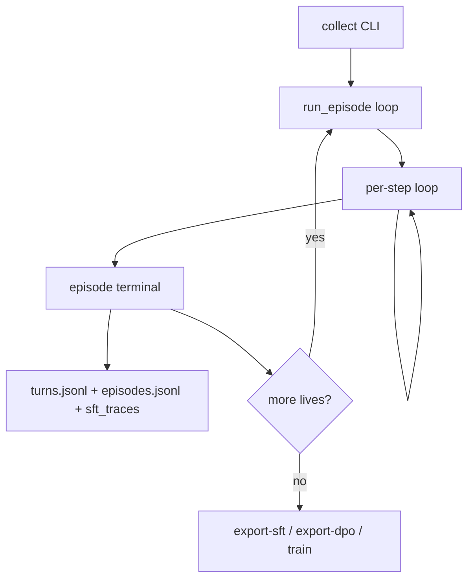

# STS2 turn-based collect system

This branch teaches a **vision-language model to play turn-based games from pixels**, starting with Slay the Spire 2 (`sts2`). Screenshot in, mouse/key out. No game API. The chapel / pad / Elden path stays in the tree but is **not** this branch's driver.

**Operator status — 8 Sep 2026:** the active STS2 path is `two_stage` with snapshot-bound ActionIntent v2. The code and offline suite are mechanically healthy, but the system is **not live-qualified**: Batch 7 has unit coverage but no completed clean live validation, and the incomplete run `20260908T202041Z_sts2_collect` shows target loss plus repeated unverified actions. Do not enable `skill_on`, export training data from this run, or claim the perception-v3 gate is closed. See the [`system audit`](AUDIT-2026-09-08.md), [`implementation plan`](IMPLEMENTATION-PLAN-2026-09-08.md), and [`perception-v3 validation report`](bugfix/perception3/validation-report.md).

Chapel-era design (pad, explore GSM, Ratchet librarian): [`loop/DESIGN.md`](loop/DESIGN.md).

## Philosophy

1. **Curiosity, not a wiki.** The planner tests one control per step. Thought names the test. Outcome writes the fact. Do not paste a UI manual into the system prompt every time a click fails.
2. **Pixels are not progress.** Hover tooltips, pause menus, and parchment flicker change pixels. Training data needs HUD or screen change: energy spent, block gained, title→map, tutorial dismissed, Resume from pause.
3. **The model's chord is the write path.** Heuristics that rewrite after the model speaks (`steer_off_danger`, hover→click) are safety, not SFT labels. Export keeps `executed_as_proposed`.
4. **Model routing must match the CLI.** STS2 `two_stage` currently defaults both LLM1 perception and ACT/reasoning to Ollama Cloud `gemma4:31b-cloud`; use `--perceive-model` and `--reasoner-model` to split them. The ACT fallback is `qwen3.5:4b-instruct-q4_K_M`. Weights update on `unsloth/Qwen3.5-4B` only when explicitly training the local model. Never `Qwen3.5-4B-Base`. Never Qwen3-VL.
5. **One live window is not an RL env.** GRPO needs multiple samples per frozen prompt. Executing eight chords on one unsaved Steam process destroys the frame. Offline DPO on logged pairs first. Live GRPO only on frozen images + scorer, or after a real snapshot reset exists.
6. **Sensor memory, not cosine thumbs.** The journal keys `kind|heading|prompt` from OCR aim labels and click outcomes. Dump-all 64×64 cosine on near-duplicate parchment frames is noise. Turn pace does not open that sqlite store.

## System at a glance

| | |
|---|---|
| Package | `loop/` |
| Fixture | `sts2` — mouse table (`action_table=sts`), `pace=turn` |
| LLM1 vision | Ollama Cloud `gemma4:31b-cloud` (`num_ctx: 8192` in two-stage) |
| ACT / reasoner | Ollama Cloud `gemma4:31b-cloud` by default (`think: false`, `num_ctx: 2048`); explicit split via `--reasoner-model`; local fallback `qwen3.5:4b-instruct-q4_K_M` |
| Architectures | **`two_stage`** (STS2 default): raw `obs.jpg` → LLM1/cached scene → typed action surface → ActionIntent v2. **`overlay`**: explicit grid/mark ablation and default for non-STS2 fixtures |
| `prompt_id` | SHA-256 prefix of frozen system prior (+ notebook schema) on every `StepLog`; **overlay vs `two_stage` hash differently**; export refuses mixed hashes |
| Default arm | `no_skill` — Notebook in every turn prompt; no cosine sqlite unless `--arm dump_all` |
| Memory scope | `--memory-scope run` (default): Known/Lessons carry across episodes in one collect run; `episode` resets journal + grounded each episode |
| Sensors | YOLO GUI is on by default. Grounding DINO is **off by default** and becomes fail-closed only when `--dino` is passed |

Out of scope on this branch: Elden explore DQN / `train-rl`, Qwen3-VL training, live 8-sample GRPO on Steam, drag (unless capture shows STS2 rejects click-click), extra UI wiki in the system prompt. Phase 2 GSM (`avatar/`, Tetris `invoke_gsm`) is a separate product path — see [`README.md`](README.md).

## Current evidence and release gate — 8 Sep 2026

The 2 Sep overlay smoke is historical evidence only. The current contract is perception-v3 plus ActionIntent v2, and its live qualification remains open.

- **Offline:** `tests/loop` passes 838 tests. The repository-wide suite passes 967 tests with `--import-mode=importlib`; the ordinary `pytest -q` command currently fails collection because `tests/test_memory.py` and `tests/loop/test_memory.py` collide under pytest's default import mode.
- **Last completed Batch 6 run:** `20260908T194352Z_sts2_collect` reached reward but reproduced one `target-not-found:enemy_2`, duplicate target rows on six steps, and a reward-screen `decision_softlock`. It is a failed validation run, not training data.
- **Batch 7 code:** adds stacked-target collapse, named-target deduplication, size-aware perception-cache invalidation, and bounded reward/map surface recovery. Unit tests cover the recorded failure shapes.
- **Latest incomplete live signal:** `20260908T202041Z_sts2_collect` has 16 logged steps and no finalized episode/summary. At the audit snapshot it had two target-not-found errors, no targets in 14/16 snapshots, 12 `effect-unverified` transactions, 14/16 forced rescans, zero reward, and zero SFT/DPO yield. Treat the run as provisional but blocking.

**Release gate:** finish a fresh, controlled combat-start run with zero noncanonical or duplicate targets, zero target/source-not-found loops, verified card effects, no decision softlock, clean reward→map handling, and complete artifact finalization. Then repeat for two consecutive combat wins. Only after that may `skill_on`, training export, or perception-v3 completion be reconsidered. Forced-rescan rate remains an efficiency gate (target ≤ 0.30), not a reason to relax correctness.

## Session lifecycle



**Run directory:** `runs/<stamp>_sts2_collect/`

| Artifact | Role |
|---|---|
| `turns.jsonl` | One `StepLog` row per step (all episodes) |
| `episodes.jsonl` | Episode rollup: terminal, success, return, audit flags |
| `frames/<ep>/<step>/` | `obs.jpg`, `vlm.jpg`, `after.jpg`, `exec.jpg` (+ optional `debug.jpg`) |
| `sft_traces.jsonl` | Auto-written at episode end (STS2) |
| `train.jsonl` | Auto-written at episode end (STS2) |
| `journal.json` | Run-scoped `FactJournal` + `MarkLexicon` (`journal.lexicon`) for STS2 collect |
| `memory_grounded.json` | `GroundedStore` snapshot (Known / Hunch / Lessons); reloaded on resume |
| `objects.db` | `ScreenObjectStore` — per-step aim frames for two_stage (`source=llm1` after entity merge) |

**Controls:** F12 panics (`release_all` + exit 130). Stop file: `data/loop/stop`. `--until-fail` raises step/timeout budgets and runs until death or win. `--no-learn` skips post-run curate only.

**Episode end:** `fixture.success()` (win, or combat + left menus, or floor-up). HUD frozen for `stuck_window` steps → `hud_identity_stuck` timeout. On fail (unless `--until-fail`): `after_fail` sends Continue chord (`g` + Enter).

## One turn, step by step — overlay (explicit STS2 ablation)

Each step in [`loop/agent/loop.py`](loop/agent/loop.py) `run_episode` when `architecture=overlay`:

1. **Wait to act** — `_wait_actable`: 64×64 thumb-poll until screen quiet (~200 ms); `act_gate` must not be enemy turn (`theirs` from `combat_turn_gate`). No VLM call while waiting.
2. **Grab + letterbox** — `grab_image` → `observe_image` crops to 16:9 content box. Wrong aspect raises before aim/clicks ([`loop/fixtures/sts2.py`](loop/fixtures/sts2.py)).
3. **HUD score (host)** — `score_sts` OCR-only → `metrics` (screen class, HP/energy/block/gold/floor). VLM JSON never mints reward numbers.
4. **Build aim marks** — `PerceptionCache` may reuse OCR words when the frame is stable (64×64 MAD ≤ 0.02). Otherwise RapidOCR words + YOLO GPA GUI boxes → `build_aim` (0–1000 grid, numbered `mk_N`); `journal.lexicon` ingest; menu words ranked first.
5. **Paint VLM frame** — `vlm.jpg` = aim overlay image (grid + cyan badges), not raw pixels. `obs.jpg` = letterboxed crop without overlay.
6. **Compose prompt** — frozen `SYSTEM_TURN_NO_SKILL` + `turn_user_prompt`: Notebook block (Goal/Focus/Avoid/Known), aim listing, HUD, `blocked_hint`, selected card.
7. **VLM call** — single `complete_json` → `thought`, `mark` / `gx,gy` / `target`, optional `goal` / `note`.
8. **Bind + safety** — ordered post-VLM chain:
   - `bind_aim` → `clamp_to_overlay`
   - `steer_to_labeled` (thought/choice → labeled mark id)
   - empty JSON → `fill_from_aim` (unused mark, never a stick)
   - `prefer_hover` / repeat-hover promote (tooltip discovery)
   - `steer_off_danger` (quit/logo skip — safety only, not SFT label)
   - Notebook ingests `goal` / `note`
9. **Stale check** — mid-think grab; if `act_gate` flipped or MAD too high, skip click (`stale-obs:*` in log).
10. **Execute** — focus window; `execute_chord`:
    - **Single click** — `mouse_click` at mark or `gx,gy`; menu labels get longer hover/hold (`MENU_HOVER_S` / `MENU_HOLD_S`). Confirm/Back click upper pennant, not fused floor glow.
    - **Hover** — unlabeled marks may hover once; labeled marks click directly.
    - **Selected card** — still click in hand band (`y ≥ 0.70` on combat) sets `_selected`; next prompt says `SELECTED: Strike — click an enemy mark`. Clears on End Turn, screen change, energy spend, two-click, Escape/pause.
    - **Two-click chord** — `{"mark": 3, "target": 7}` is two live steps (card pick, then enemy), not same-frame `target`. `gx,gy` + `gx2,gy2` same rule. Not a drag. Both points remap through letterbox.
    - `settle_ms` sleep after click; `_confirm_after_action` waits for animation quiet before after-frame.
11. **Rescore + reward** — `score_sts` on after image; `turn_reward(prev, metrics, action)` → `score_delta`. VLM `choice` merged into `metrics` for logs only.
12. **Memory writes** — `journal.record_click` (OCR aim label, not VLM mark id); `notebook.observe_step`; `_update_selected`; working memory supplies `blocked_hint` only (no last-12 in STS2 prompt).
13. **Log step** — append `StepLog` to `turns.jsonl`: `prompt_id`, `executed_as_proposed`, frame refs, timings, `score_delta`.

## One turn, step by step — two_stage (`--architecture two_stage`)

Same grab, wait, HUD, and aim-build as overlay (including `PerceptionCache` OCR/enemy reuse), then:

1. **Host stats** — `extract_sts_stats` on the letterboxed view → `_host_stats` (enemy HP bars, tutorial step, turn). Used for combat validation and entity seeding; separate from overlay `score_sts` metrics.
2. **Frame model** — `build_frame_model` from finalized aim marks → canonical `FrameObject` graph (layout archetype, interactive vs informational roles). Feeds `scene_from_ocr` when LLM1 is skipped.
3. **LLM1 gate** — `should_run_llm1_perceive`: non-combat screens always use OCR/`scene_from_ocr` (no LLM1). Combat runs LLM1 on entry, material HP/roster change, unidentified enemies, inspect/rescan/force. **`combat-stable`** skips LLM1 and merges cached scene controls with fresh OCR via `_merge_cached_combat_controls`.
4. **Perceive (LLM1)** — when gated on: raw `obs.jpg` to LLM1 (no grid on perceive input). `perceive_scene` → structured scene JSON. **Object discovery** (high recall): list every character-like sprite in `characters` / `enemies` typed slots — known name → `role=enemy`; unreadable → `role=unknown_character` + bbox on 0–1000 grid + `inspectable: true`. Never omit a creature because the name is unknown. Both model slots currently default to cloud Gemma; use `--perceive-model` or `--reasoner-model` for an explicit split. Optional `--debug-overlay` saves painted `debug.jpg` per step.
5. **Entity merge + screen reconcile** — `EntityTracker.merge_into_scene` assigns persistent ids (`unknown_character_1`, `_2`, …) by bbox proximity. Names come from **`journal.lexicon`** (`MarkLexicon`: `screen|heading` → label from OCR, hover tooltips, screen transitions) — not from HP tables. Host OCR supplies **HP pairs** for validation and `seed_enemies_from_host`; it never infers enemy names from max HP alone. `OverlayState` logs host vs LLM1 screen disagreements; host wins when set. `_ground_aim_from_scene` + `apply_enemy_bboxes` place synthetic enemy marks; grounded frames persist to `objects.db`.
6. **Freeze the action surface** — canonical store objects become a `TurnSnapshot` with snapshot id, player resources, cards, targets, controls, and legal intents. Prompt/mark-derived ids are dropped. Duplicate target rows are collapsed before publication. A failed target id must not remain executable on a later frame.
7. **Reason (text-only)** — ACT receives only the compact frozen snapshot plus a strict ActionIntent v2 schema (`play_card`, `end_turn`, `click_control`, or `inspect`). It may choose only ids advertised by that snapshot. The current ACT context is 2048. Invalid or empty intents fail closed and trigger bounded recovery rather than an invented click.
8. **Bind and execute against the current frame** — revalidate snapshot identity, bind the card source, confirm card lift/selection, refresh the observation, reacquire and dispatch a current target when required, then verify effects from host-visible state. Structured failures include `source-unconfirmed`, `target-not-found`, `effect-unverified`, `inventory-inconsistent`, and `decision-softlock`; none qualify as positive training labels.
9. **Log and learn only from truth** — persist the snapshot, intent, execution plan, card transaction, perception provenance, host metrics, and reward. Export remains gated by proposed-vs-executed agreement and verified positive outcomes.

Compare policies (note: overlay and two_stage have **different `prompt_id` hashes** — eval compares within-architecture runs only):

```powershell
python -m loop collect --fixture sts2 --architecture overlay --until-fail --no-learn
python -m loop collect --fixture sts2 --architecture two_stage --until-fail --no-learn
python -m loop eval --fixture sts2 --baseline runs\<overlay_run> --candidate runs\<overlay_sft_run>
```

**Unknown sprite discovery (two_stage combat):** LLM1 lists every creature sprite (named or `unknown_character_N` + bbox) → reasoner INSPECT → hover → tooltip OCR writes the object library → re-perceive / entity merge names the sprite → ATTACK with `choice` + `target`. Works for any enemy count and HP pool; prompt examples may say "Jaw Worm" but runtime names are always sensor-learned. Smoke-test with a short controlled combat run (`--max-steps 12–20`) before longer collects.

## Features

### Play (collect)

- **Fixture `sts2`.** Mouse table, `pace=turn`, letterbox crop, settle after each click. Window title `Slay the Spire 2` (or `AVATAR_STS2_WINDOW`). Steam app `2868840`.
- **Capture + geometry.** Client must be ~16:9 (borderless 1280×720 / 1920×1080); collect refuses a tall/wrong-aspect grab and otherwise snaps content to 16:9 before aim/clicks.
- **OCR aim.** CPU RapidOCR (PP-OCRv6 ONNX) with Tesseract fallback (`AVATAR_OCR=tesseract|off`). Menu words (`:Continue`, `:Singleplayer`, `:Confirm`, `:Resume`, `:Got it`, `:Back`, `:End Turn`) rank first; hand/board unit names (Strike, enemies) on leftover OCR. Unlabeled top-bar chrome (`:icon`, gold digits) dropped.
- **GUI detector (required).** YOLO GPA interactable boxes are part of the STS2 production stack (`--gui`, `--gui-device cpu`, `--gui-model gpa|groundcua`). `ultralytics` and `huggingface_hub` are core dependencies; GPA weights live under `data/loop/weights/gpa-gui/`. `--no-gui` is diagnostic-only, not a baseline collect configuration. OCR labels attach to GUI boxes by IoU. The 2 Sep 2026 smoke test detected the character-select checkmark on CPU.
- **Aim overlay + object library.** 0–1000 grid + numbered cyan marks. **`MarkLexicon`** (`journal.lexicon`) is the spatial object library: `screen|heading → label`, keyed by quantized click position (not `mk_N`). Slots are sensor-written only — OCR ingest, hover-tooltip OCR, screen-transition hints (`discover_click`). Live OCR wins over memory; VLM `choice` does not write slots. `forget()` drops a slot after a blocked click. `EntityTracker.apply_object_library()` and `seed_enemies_from_host(..., lexicon=...)` resolve names at sprite positions. If thought/choice names a labeled word but JSON copies an example mark id, `steer_to_labeled` rewrites to that id.
- **Perception cache.** `PerceptionCache` reuses OCR words when the 64×64 thumb MAD ≤ 0.02 or frame hash matches. In combat (two_stage), also reuses enemy-band aim marks when roster signature and enemy-band MAD are stable; invalidates on roster change, inspect, or rescan. Logs cache reason (`frame-stable`, `combat-enemies`, …) in step output.
- **Frame model.** `build_frame_model` turns finalized aim marks into a `FrameModel`: layout archetype (`hand_and_board`, `modal_dialog`, `paginated_overlay`, …), interactive vs informational roles, and `interactive_labels()` for reasoner allowed-controls when LLM1 is skipped.
- **Grounding DINO (opt-in sensor).** The CLI defaults it off. Passing `--dino` loads it before the first step and makes its availability fail-closed for non-fake fixtures. In STS2 it grounds a bounded UI query list before aim construction; only OCR/YOLO-co-verified DINO boxes become actionable marks. The raw boxes, timing, painted frame, and detector family are logged. Do not compare DINO and non-DINO runs as the same sensor configuration.
- **Unknown sprite discovery (two_stage).** LLM1 object discovery lists every character-like sprite in `characters` / `enemies` — named enemies, `unknown_character`, player-adjacent sprites, and bbox-only `unidentified_enemy`. Multiple enemies each get a persistent id. `EntityTracker` + `MarkLexicon` (object library) identify sprites by position after hover/OCR/LLM1 read the name on screen. Reasoner may INSPECT before ATTACK when targets are unidentified; hover triggers re-perceive and lexicon tooltip OCR. No HP→name lookup table.
- **Enemy-turn gate.** `Sts2Fixture.act_gate` → `combat_turn_gate`. Agent waits during enemy turn; stale obs after think skips the click.
- **Live score.** `score_sts` is OCR-only. Screen class uses markers (map `legend` beats shop `merchant`; potion/view-upgrades copy is tutorial). HP/energy/block only on `combat`; gold/floor on map-like screens. Unclassified frames do not mint HUD numbers. Each step uses `turn_reward` (screen rank, Resume, card+target energy/block/HP/gold/floor). Pixel-only no-ops score 0.
- **Two-click chord.** Two live steps: pick card, then click enemy. Same-frame `target` in JSON is not executed as a drag.
- **Selected card.** Hand-band click sets selection; blocked hint steers to enemy when three no-op clicks repeat on same bind.
- **Blocked hint.** Three unchanged `mk_*`/`pt_*` clicks say click an enemy while a card is selected, not "pick different gx,gy".
- **Journal.** Run-scoped `journal.json` per collect run. `record_click` stores OCR aim label under `kind|heading|prompt`. First no-change click is `noop` (not persisted); repeat on same bind → `blocked`.
- **Notebook + grounded facts.** Standing mission: `Goal: learn every control and win a run`. JSON `goal` is this-step Focus only. Play graph + **`GroundedStore`** (Known / Hunch / Lessons) sliced into user prompt; sensor outcomes and positive `turn_reward` promote to verified Known. `decay_grounded` ages off-screen facts. PIVOT on repeated no-ops. Persisted to `memory_grounded.json`.
- **Overlay state (two_stage).** `OverlayState` suppresses stale tutorial OCR for a few steps after dismissal; logs host vs LLM1 screen disagreements (host wins in `resolved_screen`).
- **Pause is not death.** OCR `Give Up` / `Save and Quit` on pause is not `fail_screen`. Escape opens pause; click Resume.
- **Success.** `terminal == win`, or left menus into combat / floor-up. Reaching combat counts. Survive-K does not.
- **`prompt_id`.** SHA-256 prefix of frozen system prior (+ `notebook_schema=v1`) on every `StepLog`. **Overlay and `two_stage` produce different hashes** (two_stage hashes perceive + reason priors). Export/eval refuse mixed hashes or mixed notebook schema versions.
- **Default arm `no_skill`.** Notebook in every STS2 user prompt; cosine sqlite only with `--arm dump_all`.

### Train

- **SFT gate.** `executed_as_proposed` and `turn_reward > 0`. Fail-episode Continue on title can stay; Escape/Give Up/logo cannot. Chat JSONL uses `SYSTEM_TURN_NO_SKILL` and mark / gx / target — not `stick_l`.
- **DPO.** Same `vlm.jpg` (true same-frame) or matching `state_key` `(screen, hp, energy, floor, block)` **and** matching `notebook_snapshot` when present. Chosen = progress chord, rejected = no-op or danger. `safety_override` pairs use executed vs proposed when VLM was empty or danger.
- **DPO train.** `python -m loop train-dpo --fixture sts2` runs ORPO/DPO on exported pairs. Unloads Ollama before 4-bit train, same VRAM schedule as SFT.
- **Post-episode auto-writes.** At each STS2 episode end: `write_sft_jsonl` and `write_train_jsonl` into the run dir.
- **Eval counters.** `turn_run_metrics`: tutorial-clear, title→map, combats started, mean floor, false-fail, two-click rate, Escape rate, success rate, `prompt_ids`. Compare with `python -m loop eval --fixture sts2 --baseline <dir> --candidate <dir>`.

## Process

### Sources of truth

When prose and runtime disagree, use this order:

1. `loop/__main__.py`, `loop/config.py`, and the current schemas/tests define actual CLI behavior.
2. This file is the operator contract and should be corrected whenever behavior intentionally changes.
3. `bugfix/perception3/validation-report.md` records dated live evidence; a code-landed batch is not a passed gate.
4. `configs/experiment.yaml` configures the separate `avatar/` experiment path and does not set `python -m loop collect` defaults.

### Readiness checks

Safe offline check (does not send live mouse/keyboard input):

```powershell
$env:AVATAR_LIVE_INPUT='0'
python -m pytest -q --import-mode=importlib
python -m pip check
python -m compileall -q avatar loop tests scripts eval bugfix
```

The import-mode flag is currently required for the repository-wide suite because two test files share the basename `test_memory.py`. A durable pytest configuration or rename is still needed before plain `pytest -q` is a valid health check. Live-input tests require an explicit `AVATAR_LIVE_INPUT=1` and are never part of unattended regression checks.

Before a live qualification run: use a fresh known combat state, keep the client at the validated 16:9 size, record architecture/models/sensor flags, confirm the stop file is absent, and run the monitor. A qualifying run must end with `episodes.jsonl` and `summary.json`; an orphaned `turns.jsonl` is diagnostic evidence only.

```text
screenshot → letterbox crop → perception cache? → aim overlay (OCR + GUI)
  → [overlay: VLM JSON | two_stage: LLM1/cache → canonical action surface]
  → two_stage ActionIntent v2 → snapshot bind → source confirmation → fresh target bind
  → click/target dispatch → settle → host-visible effect verification → HUD OCR
  → turn_reward → journal + notebook/grounded → StepLog (prompt_id, architecture, transaction)
  → filter turn_reward > 0 → SFT on Qwen3.5-4B
  → DPO pairs on same frame → train-dpo
  → eval --baseline vs --candidate on frozen prompt_id
  → worse? collect again, do not mix hashes
```

VRAM on the 4060: **PLAN (Ollama) → unload → TRAIN (4-bit LoRA)**. Do not co-resident.

### Cycle

Inspect yield, pool same-`prompt_id` runs, sandbox SFT, write DPO pairs, then merge a full-precision master and GGUF it back onto `qwen3.5:4b-instruct-q4_K_M`. Path A GRPO scores frozen frames only — never a live Steam window.

```powershell
python -m loop inspect-run --fixture sts2 [--all-runs]
python -m loop benchmark-perceive --fixture sts2 [--prompts v1,v2] [--offline-ocr]
python -m loop export-sft --fixture sts2 [--run-dir ... --all-runs]
python -m loop export-dpo --fixture sts2
python -m loop train-sft --fixture sts2
python -m loop train-dpo --fixture sts2
python -m loop cycle --fixture sts2 [--execute]
python -m loop eval --fixture sts2 --baseline runs\<base>_sts2_collect --candidate runs\<sft>_sts2_collect
python -m loop collect --fixture sts2 --policy heuristic --no-learn
python -m loop export-frames --fixture sts2
python -m loop vram-probe
python -m loop train-grpo --frames runs/<stamp>_sts2_collect/frozen_frames.jsonl [--execute]
```

Export and train default `--source vlm` (drops heuristic rows). `--source heuristic` keeps only seed policy. `--source all` keeps both.

`--skip-models` on sts2 uses the heuristic proposer (`sts2-heuristic-v1`), not keyboard round-robin. `train-rl` stays Elden DQN.

### 1. Collect

Game in borderless window, focused. F12 panics. Stop file: `data/loop/stop`.

```powershell
# STS2 default: two_stage, cloud Gemma for both slots, YOLO GUI on, DINO off:
python -u -m loop collect --fixture sts2 --until-fail --no-learn --countdown 3
# Explicit split: cloud Gemma LLM1 + local Qwen reasoner:
python -u -m loop collect --fixture sts2 --architecture two_stage --perceive-model gemma4:31b-cloud --reasoner-model qwen3.5:9b-q4_K_M --until-fail --no-learn
# Explicit overlay ablation:
python -u -m loop collect --fixture sts2 --architecture overlay --until-fail --no-learn --countdown 3
# Explicit Grounding DINO sensor (fails closed if unavailable):
python -u -m loop collect --fixture sts2 --dino --until-fail --no-learn --countdown 3
# Episode-scoped memory (reset Known each episode):
python -u -m loop collect --fixture sts2 --memory-scope episode --until-fail --no-learn
# Smoke-test unknown-sprite discovery through first combat (short run, not 80 steps):
python -u -m loop collect --fixture sts2 --architecture two_stage --max-steps 20 --no-learn --countdown 3
# Optional painted debug overlay per step:
python -u -m loop collect --fixture sts2 --architecture two_stage --debug-overlay --until-fail --no-learn
# Opt-in cosine ablation (not default):
python -u -m loop collect --fixture sts2 --arm dump_all --until-fail --no-learn --countdown 3
```

`--no-learn` skips post-run curate only. Default arm is **`no_skill`**. **`dump_all`** opens cosine sqlite recall — opt-in ablation only. Empty JSON fills an unused aim mark, never a stick.

### 2. Inspect a run

`runs/<stamp>_sts2_collect/` holds `turns.jsonl`, `episodes.jsonl`, `frames/`, `sft_traces.jsonl`, `train.jsonl`, `journal.json`, `memory_grounded.json`, and (two_stage) `objects.db`. `inspect-run` reads `turns.jsonl`. Look at `vlm.jpg` (grid + marks), `choice`, `pixel_changed`, `metrics.screen`, `score_delta`, and (two_stage) `perceive_raw` / `reason_raw` / `architecture`. Pause + Give Up must not be `terminal=fail`.

### 3. Export SFT

```powershell
python -m loop export-sft --fixture sts2
python -m loop train-sft --fixture sts2
```

Dry-run writes Unsloth chat JSONL and sandboxes the set. `--execute` runs QLoRA (`unsloth/Qwen3.5-4B`, `fast_inference=False`, vision LoRA off, 4-bit). Merge + GGUF `q4_K_M` back onto `qwen3.5:4b-instruct-q4_K_M`.

### 4. Export DPO

```powershell
python -m loop export-dpo --fixture sts2
python -m loop train-dpo --fixture sts2
```

Train DPO/ORPO on those pairs before any group-relative RL. Dry-run writes pair JSONL and sandboxes; `--execute` runs 4-bit train with the same unload-Ollama schedule as SFT.

### 5. Eval (held out)

Same harness, same `prompt_id`. Compare base instruct vs SFT vs DPO on the same seed lives:

```powershell
python -m loop eval --fixture sts2 --baseline runs\<base>_sts2_collect --candidate runs\<sft>_sts2_collect
```

Compares `turn_run_metrics` on two collect run dirs (same `prompt_id`). Collect each policy separately, then pass the directories. Do not declare a win from training loss.

### 6. Later: GRPO / GSPO

Only Path A: groups are **frozen frames** scored by `frozen_score` (no execution). `train-grpo` hard-refuses a live window. Then GSPO: `importance_sampling_level="sequence"`, `loss_type="dr_grpo"`, `num_ctx=4096`, never vLLM `fast_inference` on Qwen3.5. **Do not** `python -m loop train-rl` on STS2 (that is four Elden sticks).

## Reward inequalities (sandbox)

Checked by `sandbox_turn_reward()`:

- Resume > Escape
- card+target (energy/block) > card-only select
- Continue (title→map) > logo click with pixels
- card+target > Continue (transition cap so a menu click cannot outrun a real play)

Death/victory OCR: ±1. Pause Give Up is not death.

## Memory (stores)

| Store | When | Role |
|---|---|---|
| **FactJournal** | always | Sensor facts + bindings (`kind|heading|prompt`). Backing store; not the STS2 prompt block. Run-scoped `journal.json` on STS2 collect. |
| **MarkLexicon** (`journal.lexicon`) | always | `screen|heading → label`. Hover tooltips, OCR marks, transitions. Names unidentified sprites for entity merge and aim seeding. |
| **GroundedStore** (`notebook.grounded`) | always (STS2 turn) | Verified Known / Hunch / Lessons promoted from sensor outcomes and positive reward. Decays off-screen; saved to `memory_grounded.json`. |
| **Notebook** | always (STS2 turn) | The only memory block in the STS2 user prompt (Goal / Focus / Hint / Last / Avoid / Known / Hunch / Lessons). |
| **WorkingMemory** | STS2 turn | `blocked_hint` only; `turn_user_prompt` does not inject last-12 chords. |
| **PerceptionCache** | every step | Frame-stable OCR reuse; combat enemy-mark reuse (two_stage). Invalidates on screen change, roster change, inspect, rescan. |
| **EntityTracker** | two_stage combat | Persistent sprite ids (`unknown_character_N`); merges LLM1 bboxes + lexicon names. |
| **OverlayState** | two_stage | Tutorial dismissal OCR suppression; host/perceive screen disagreement log. |
| **ScreenObjectStore** | two_stage | `objects.db` — per-step grounded aim frames after LLM1 entity merge. |
| **MemoryStore** cosine | `--arm dump_all` only | Opt-in ablation. SkillBank (`--arm ratchet`) is also opt-in and off for STS2. |

## Code map

| Piece | Where |
|---|---|
| Turn loop (collect agent) | [`loop/agent/loop.py`](loop/agent/loop.py) |
| Turn prior + `prompt_id` | [`loop/agent/prompts.py`](loop/agent/prompts.py) |
| Heuristic seed policy | [`loop/agent/heuristic.py`](loop/agent/heuristic.py) |
| Scene perceive (LLM1) + gate | [`loop/agent/perceive.py`](loop/agent/perceive.py) |
| Entity tracker (unknown → named) | [`loop/agent/entities.py`](loop/agent/entities.py) |
| Perception cache (OCR/enemy reuse) | [`loop/agent/perception_cache.py`](loop/agent/perception_cache.py) |
| Object library (spatial lexicon) | [`loop/memory/lexicon.py`](loop/memory/lexicon.py) (via `journal.lexicon`) |
| Grounded facts (Known/Hunch) | [`loop/memory/grounded.py`](loop/memory/grounded.py) |
| Overlay dismissal / screen reconcile | [`loop/memory/overlay_state.py`](loop/memory/overlay_state.py) |
| Chord parse (`target`, `gx2`) | [`loop/os/chords.py`](loop/os/chords.py) |
| Bind marks + overlay | [`loop/os/aim.py`](loop/os/aim.py) |
| GUI detector (YOLO GPA) | [`loop/os/gui.py`](loop/os/gui.py) |
| Frame model (object graph) | [`loop/os/frame_model.py`](loop/os/frame_model.py) |
| Host stats extract (two_stage) | [`loop/os/sts_stats.py`](loop/os/sts_stats.py) |
| Two-click execute | [`loop/fixtures/sts2.py`](loop/fixtures/sts2.py) |
| HUD + `turn_reward` + combat gate | [`loop/reward/sts.py`](loop/reward/sts.py) |
| Frozen-frame scorer | [`loop/reward/frozen_score.py`](loop/reward/frozen_score.py) |
| Journal labels | [`loop/memory/journal.py`](loop/memory/journal.py) |
| Notebook (STS2 prompt) | [`loop/memory/notebook.py`](loop/memory/notebook.py) |
| Blocked hint | [`loop/memory/episodic.py`](loop/memory/episodic.py) |
| Screen object store (two_stage) | [`loop/memory/screen_objects.py`](loop/memory/screen_objects.py) |
| MCP tools + orchestrator | [`loop/mcp/orchestrator.py`](loop/mcp/orchestrator.py) |
| Perceive prompt benchmark | [`loop/eval/perceive_benchmark.py`](loop/eval/perceive_benchmark.py) |
| SFT / DPO export | [`loop/eval/export.py`](loop/eval/export.py), [`loop/eval/sft.py`](loop/eval/sft.py) |
| DPO train | [`loop/eval/dpo.py`](loop/eval/dpo.py) |
| Path A GRPO | [`loop/eval/grpo.py`](loop/eval/grpo.py) |
| Step log schema | [`loop/log/schema.py`](loop/log/schema.py) |
